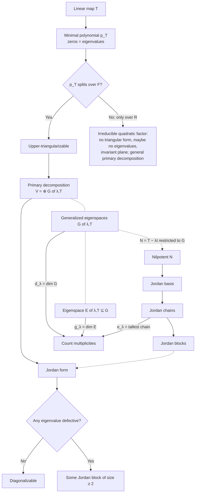

Notes on eigenvalues, eigenspaces, and generalized eigenspaces, organized around
one theme: how the factorization of the minimal polynomial determines the
structure of an operator. Along the way: invariant subspaces, the normal forms
(triangular, primary, Jordan, diagonal), eigenspaces of $p(T)$, and a few
analytic facts.

A map of the post:

## Notation and Standing Assumptions

Unless stated otherwise, $T \in \mathcal{L}(V)$. Results that genuinely need
$\mathbf{F} = \mathbb{C}$ say so explicitly.



## Invariant Subspaces

{: .prompt-info }
> Sums and arbitrary intersections of $T$-invariant subspaces are $T$-invariant.

{: .prompt-info }
> A $T$-invariant subspace is invariant under $p(T)$ for every $p \in \mathcal{P}(\mathbf{F})$.

{: .prompt-proof }
> The operators leaving the subspace invariant are closed under sums, products and scalar multiples, and contain $I$ and $T$, so they contain every $p(T)$. $\blacksquare$

{: .prompt-info }
> $\operatorname{null}p(T)$ and $\operatorname{range}p(T)$ are $T$-invariant for every $p \in \mathcal{P}(\mathbf{F})$. In particular $E(\lambda,T)$ and $G(\lambda,T)$ are $T$-invariant.

{: .prompt-proof }
> $p(T)$ commutes with $T$. If $p(T)v = 0$ then $p(T)(Tv) = T\,p(T)v = 0$; and $T\,p(T)v = p(T)(Tv) \in \operatorname{range}p(T)$. The same argument works for any operator commuting with $T$; see [Commuting Operators](#invariant-subspaces). $\blacksquare$

{: .prompt-info }
> **Invariant direct sums.** Suppose $V = V_1 \oplus \dots \oplus V_m$ with each $V_k$ invariant under $T$, and write $T_k = \left.T\right\rvert_{V_k}$. Then for every $p \in \mathcal{P}(\mathbf{F})$:
>
> (a) $\operatorname{null}p(T) = \bigoplus_k \operatorname{null}p(T_k)$ and $\operatorname{range}p(T) = \bigoplus_k \operatorname{range}p(T_k)$.
>
> (b) The minimal polynomial of $T$ is the lcm of those of the $T_k$.

{: .prompt-proof }
> Each $V_k$ is invariant under $p(T)$, and $\left.p(T)\right\rvert_{V_k} = p(T_k)$. So writing $v = \sum_k v_k$ with $v_k \in V_k$, we get $p(T)v = \sum_k p(T_k)v_k$ with $p(T_k)v_k \in V_k$. So the $p(T_k)v_k$ are the components of $p(T)v$ in $V = \bigoplus_k V_k$, and since components are unique, $p(T)v = 0$ iff every $p(T_k)v_k = 0$. That is the null-space formula. For the range, the same expression shows $\operatorname{range}p(T) = \sum_k \operatorname{range}p(T_k)$, and this sum is direct because $\operatorname{range}p(T_k) \subseteq V_k$. For (b), by (a) $p(T) = 0$ iff every $p(T_k) = 0$, i.e. iff the minimal polynomial of every $T_k$ divides $p$, i.e. iff their lcm divides $p$. $\blacksquare$

{: .prompt-info }
> Every subspace $U$ of an eigenspace $E(\lambda,T)$ is $T$-invariant: for $u \in U$, $Tu = \lambda u \in U$.

{: .prompt-info }
> Suppose $ k \in \\{ 1, \dots, n - 1 \\} $. The following are equivalent:
>
> (a) $T$ is a scalar multiple of $I$.
>
> (b) Every subspace of $V$ is $T$-invariant.
>
> (c) Every $k$-dimensional subspace of $V$ is $T$-invariant.

{: .prompt-proof }
> **(a) $\Rightarrow$ (b).** If $T = \lambda I$, then $E(\lambda,T) = V$; apply the box above.
>
> **(b) $\Rightarrow$ (c).** Immediate.
>
> **(c) $\Rightarrow$ (a).** Two steps.
>
> *Step 1: every nonzero vector is an eigenvector.* Let $v \ne 0$ and suppose $Tv \notin \operatorname{span}(v)$. Then $v, Tv$ are linearly independent, so extend them to a basis $v, Tv, x_3, \dots, x_n$. Since $k \le n - 1$, the list $v, x_3, \dots, x_{k+1}$ exists (it is just $v$ when $k = 1$). Its span $U$ is a $k$-dimensional subspace that contains $v$ but not $Tv$, so $U$ is not invariant, contradicting (c).
>
> *Step 2: all eigenvectors share one eigenvalue.* By Step 1, every nonzero $u$ has a scalar $\lambda_u$ with $Tu = \lambda_u u$. Let $u, w$ be nonzero.
>
> - If $w = cu$, then $Tw = c\,Tu = \lambda_u w$, so $\lambda_w = \lambda_u$.
> - If $u, w$ are independent, then $u + w \ne 0$, and comparing coefficients in
>
>   $$\lambda_{u+w} u + \lambda_{u+w} w = T(u+w) = \lambda_u u + \lambda_w w$$
>
>   gives $\lambda_u = \lambda_{u+w} = \lambda_w$.
>
> So $\lambda_u$ is a single scalar $\lambda$, and $T = \lambda I$. $\blacksquare$

## Eigenvalues and the Minimal Polynomial

{: .prompt-info }
> $\sigma(T)$ is exactly the set of zeros of $p_T$ in $\mathbf{F}$.

{: .prompt-proof }
> If $Tv = \lambda v$ with $v \ne 0$, then $0 = p_T(T)v = p_T(\lambda)v$, so $p_T(\lambda) = 0$. Conversely, if $p_T(\lambda) = 0$, write $p_T = (z - \lambda)q$. Then $q(T) \ne 0$ by minimality, so $v = q(T)w \ne 0$ for some $w$, and $(T - \lambda I)v = p_T(T)w = 0$. So $v$ is an eigenvector for $\lambda$. $\blacksquare$

{: .prompt-tip }
> The factorization of $p_T$ matches the structure of $T$ in three increasingly detailed ways, and the rest of the post fills them in:
>
> 1. the zeros of $p_T$ are the eigenvalues (the box above);
> 2. the exponent $e_\lambda$ of $z - \lambda$ is the index of $T - \lambda I$ ([The Nilpotent Part](#the-nilpotent-part));
> 3. the coprime factors $(z - \lambda)^{e_\lambda}$ cut $V$ into the direct sum of the $G(\lambda,T)$.
>
> Item 3 is the split case of the **primary decomposition**, which holds over any field: if $p_T = q_1^{r_1}\cdots q_s^{r_s}$ with distinct monic irreducible $q_i$, then $V = \bigoplus_i \operatorname{null}q_i(T)^{r_i}$, each summand $T$-invariant. The proof is the Bézout projection argument of [invariant subspaces (c)](#the-nilpotent-part) with $q_i^{r_i}$ in place of $(z - \lambda_i)^{e_i}$. Over $\mathbb{R}$ with $p_T = (z - 1)(z^2 + 1)$, it gives $V = \operatorname{null}(T - I) \oplus \operatorname{null}(T^2 + I)$, the second summand a rotation plane with no eigenvalues.

### Existence of Eigenvalues

Since $\sigma(T)$ is the [set of zeros of $p_T$](#eigenvalues-and-the-minimal-polynomial) in $\mathbf{F}$, whether $T$ has eigenvalues depends on how $p_T$ factors over $\mathbf{F}$.

{: .prompt-info }
> (a) Over $\mathbb{C}$, $\sigma(T) \ne \varnothing$.
>
> (b) Over $\mathbb{R}$, $\sigma(T) = \varnothing$ exactly when $p_T$ has no real zero, as for rotation by $\pi/2$ on $\mathbb{R}^2$, with $p_T = z^2 + 1$. This cannot happen when $n$ is odd.
>
> (c) Over $\mathbb{R}$, $T$ always has an invariant subspace of dimension $1$ or $2$.

{: .prompt-proof }
> (a) $p_T$ has degree at least $1$ since $V \ne \\{0\\}$, so it has a complex zero.
>
> (b) The first claim is the fact above. For odd $n$, see [Complexification](#application-odd-dimension-forces-a-real-eigenvalue).
>
> (c) Let $q$ be an irreducible factor of $p_T$, so $\deg q \in \\{1, 2\\}$, and write $p_T = qh$. By minimality $h(T) \ne 0$, so $w = h(T)v \ne 0$ for some $v$, and $q(T)w = p_T(T)v = 0$. Then $T^{\deg q}w \in \operatorname{span}(w, \dots, T^{\deg q - 1}w)$, so this span is invariant, nonzero, and of dimension at most $\deg q \le 2$. $\blacksquare$

{: .prompt-tip }
> Over $\mathbb{R}$ the role of an eigenvector is played by an invariant plane on which $T$ acts as a rotation-scaling with a conjugate pair of eigenvalues of $T_{\mathbb{C}}$. This is why the hierarchy of normal forms below assumes the minimal polynomial splits: without it, even the upper-triangular form fails.

## Null Space and Range Chains

Several chains of subspaces in these notes are built the same way: each term is obtained from the previous one by a fixed rule. Such a chain stops for good the first time it stalls.

{: .prompt-info }
> *Stabilizing chains*
>
> Let $U_0, U_1, U_2, \dots$ be subspaces of $V$ with $U_{m+1} = F(U_m)$ for a fixed rule $F$ taking subspaces to subspaces.
>
> (a) If $U_k = U_{k+1}$, then $U_m = U_k$ for every $m \ge k$.
>
> (b) If the chain is increasing ($U_m \subseteq U_{m+1}$) or decreasing ($U_m \supseteq U_{m+1}$), then $U_k = U_{k+1}$ for some $k \le n$, and before that step the dimension changes by at least $1$ at each step.

{: .prompt-proof }
> (a) $U_{k+2} = F(U_{k+1}) = F(U_k) = U_{k+1}$; induction does the rest.
>
> (b) While $U_m \ne U_{m+1}$, one contains the other properly, so the dimensions differ by at least $1$. The dimensions stay in $\\{0, \dots, n\\}$, so there are at most $n$ such steps. $\blacksquare$

| Chain | Rule $F$ | Stalls at |
| --- | --- | --- |
| $\operatorname{null}T^m$ (increasing) | $U \mapsto T^{-1}(U)$, the preimage | the index of $T$ |
| $\operatorname{range}T^m$ (decreasing) | $U \mapsto T(U)$ | the index of $T$ |
| Krylov subspaces $\operatorname{span}(v, Tv, \dots, T^mv)$ (increasing) | $U \mapsto \operatorname{span}(v) + T(U)$ | $\deg p_v - 1$, see [Polynomials](#local-minimal-polynomial) |

{: .prompt-info }
> Suppose $m$ is a nonnegative integer. Then
>
> $$ \operatorname{null} T^m = \operatorname{null} T^{m + 1} \iff \operatorname{range} T^m = \operatorname{range} T^{m + 1} $$
>
> and once either holds at $m$, it holds at every $m' \ge m$.

{: .prompt-proof }
> $\operatorname{null}T^m \subseteq \operatorname{null}T^{m+1}$ and $\operatorname{range}T^m \supseteq \operatorname{range}T^{m+1}$, so each equality holds iff the dimensions agree. By rank–nullity, $\dim\operatorname{null}T^m + \dim\operatorname{range}T^m = n$ for every $m$, so the null spaces have equal dimension iff the ranges do. The second claim is (a) of the lemma, with the rules in the table. $\blacksquare$

{: .prompt-tip }
> So the null-space chain and the range chain stabilize at the *same* step; this common step is the **index** of $T$ (in operator theory, the *ascent* and *descent*, which are equal here). By (b) of the lemma, the chains have stabilized by $m = n$. This is why $G(\lambda,T) = \operatorname{null}(T-\lambda I)^n$ is a safe uniform definition. The true index of $T - \lambda I$ is usually much smaller, namely $e_\lambda$ (proved in [The Nilpotent Part](#the-nilpotent-part) below).

{: .prompt-info }
> For every $k \ge 1$,
>
> $$V = \operatorname{null}T^k \oplus \operatorname{range}T^k \iff k \ge \text{the index of } T.$$
>
> In particular $V = \operatorname{null}T^n \oplus \operatorname{range}T^n$ always, and $V = \operatorname{null}T \oplus \operatorname{range}T$ iff the index is at most $1$.

{: .prompt-proof }
> First, for any operator $S$: $V = \operatorname{null}S \oplus \operatorname{range}S \iff \operatorname{null}S = \operatorname{null}S^2$.
>
> - *($\Rightarrow$)* If $v \in \operatorname{null}S^2$, then $Sv \in \operatorname{null}S \cap \operatorname{range}S = \\{0\\}$, so $v \in \operatorname{null}S$.
> - *($\Leftarrow$)* If $Su \in \operatorname{null}S$, then $u \in \operatorname{null}S^2 = \operatorname{null}S$, so $Su = 0$. Hence $\operatorname{null}S \cap \operatorname{range}S = \\{0\\}$, and the dimensions add up to $n$ by rank–nullity.
>
> Apply this to $S = T^k$. Since $\operatorname{null}T^k \subseteq \operatorname{null}T^{k+1} \subseteq \operatorname{null}T^{2k}$, the condition $\operatorname{null}T^k = \operatorname{null}T^{2k}$ holds iff the chain has stopped growing by step $k$, i.e. $k \ge$ the index. The index is at most $n$. $\blacksquare$

## Generalized Eigenspaces

Suppose the distinct eigenvalues of $T$ are $ \lambda_1, \dots, \lambda_m $.

|                                  | $G(\lambda_k,T)$                                                                           | $E(\lambda_k,T)$                                                            |
| -------------------------------- | ------------------------------------------------------------------------------------------ | --------------------------------------------------------------------------- |
| Definition                       | $\operatorname{null}(T-\lambda_k I)^{j}$, any $j \ge e_{\lambda_k}$ ($j = n$ always works) | $\operatorname{null}(T-\lambda_k I)$                                        |
| Containment                      | $E \subseteq G$                                                                            | —                                                                           |
| Restriction of $T - \lambda_k I$ | nilpotent, index exactly $e_{\lambda_k}$                                                   | zero                                                                        |
| Every subspace $T$-invariant     | iff $G = E$ ([see below](#the-nilpotent-part))                                             | always                                                                      |
| Sum is direct                    | always                                                                                     | always                                                                      |
| Sum is all of $V$                | iff the minimal polynomial splits over $\mathbf{F}$ (automatic over $\mathbb{C}$)          | iff $T$ diagonalizable                                                      |
| Multiplicity                     | algebraic $d_{\lambda_k} = \dim G$                                                         | geometric $g_{\lambda_k} = \dim E$, $1 \le g_{\lambda_k} \le d_{\lambda_k}$ |
| Min. polynomial                  | $\prod_k (z-\lambda_k)^{e_{\lambda_k}}$                                                    | $\prod_k(z-\lambda_k)$ **iff diagonalizable**                               |
| Char. polynomial                 | $\prod_k (z-\lambda_k)^{d_{\lambda_k}}$                                                    | — (always uses $d_{\lambda_k}$)                                             |

{: .prompt-info }
> An eigenvalue $\lambda$ of $T$ is called **defective** when $\dim E(\lambda, T) \;<\; \dim G(\lambda, T)$, i.e. $g_\lambda < d_\lambda$.

{: .prompt-tip }
> Directness of the sum of eigenspaces says eigenvectors with distinct eigenvalues are linearly independent. Conversely, every linearly independent list $v_1, \dots, v_m$ arises this way: extend it to a basis $v_1, \dots, v_n$ and define $T$ by $Tv_k = kv_k$ for $k \le m$ and $Tv_k = 0$ for $k > m$.

{: .prompt-tip }
> **Blockwise computation.** For $V = V_1 \oplus \dots \oplus V_m$ with each $V_k$ invariant, [invariant direct sums](#invariant-subspaces) with $p = (z - \lambda)^j$ give $\operatorname{null}(T - \lambda I)^j = \bigoplus_k \operatorname{null}(T_k - \lambda I)^j$ for every $j$. Taking $j = 1$ and $j = n$ (the chains of $T_k - \lambda I$ stabilize by $\dim V_k \le n$): $E(\lambda,T) = \bigoplus_k E(\lambda,T_k)$ and $G(\lambda,T) = \bigoplus_k G(\lambda,T_k)$. So $g_\lambda$ and $d_\lambda$ add across the blocks, the index of $T - \lambda I$ is the max of the blockwise ones (so $e_\lambda = \max_k e_\lambda^{(k)}$, matching the lcm), and the characteristic polynomial is the **product** of the blocks'.

### The Nilpotent Part

Every eigenvalue produces a nilpotent operator. If $\lambda$ is an eigenvalue of $T$, then $G(\lambda,T)$ is [invariant](#invariant-subspaces) under $T$, and

$$N := \left.(T - \lambda I)\right\rvert_{G(\lambda,T)}$$

is nilpotent. So everything in [Nilpotent Operators]() applies to this $N$, acting on the space $G(\lambda,T)$ of dimension $d_\lambda$: it has a Jordan basis and a diagram, with partition $\mu = (m_1 \ge \dots \ge m_k)$, conjugate partition $\mu'$, index of nilpotency $p = m_1$, and $d_j = \dim\operatorname{null}N^j$. The parts $m_i$ are the sizes of the Jordan blocks of $T$ for $\lambda$.

{: .prompt-warning }
> Two notations meet here. The algebraic multiplicity $d_\lambda = \dim G(\lambda,T)$ is indexed by an eigenvalue; $d_j = \dim\operatorname{null}N^j$ is indexed by a power. They are compatible: $d_j = d_\lambda$ for every $j \ge p$.

{: .prompt-tip }
> Since $\left.T\right\rvert_{G(\lambda,T)} = \lambda I + N$, for every scalar $\alpha \ne \lambda$
>
> $$\left.(T - \alpha I)\right\rvert_{G(\lambda,T)} = (\lambda - \alpha)I + N$$
>
> is invertible, by [Inverse of a Jordan Block](#inverse-of-a-jordan-block). So $\lambda$ is the only eigenvalue of $\left.T\right\rvert_{G(\lambda,T)}$, and taking $\alpha = 0$, $\left.T\right\rvert_{G(\lambda,T)}$ is invertible when $\lambda \ne 0$.

At the other extreme, $T$ is nilpotent iff $G(0,T) = \operatorname{null}T^n = V$, since a nilpotent operator satisfies $T^n = 0$.

The three numbers attached to $\lambda$ are read off the diagram of $N$:

|                                   | reads off as                     | on the diagram               |
| --------------------------------- | -------------------------------- | ---------------------------- |
| $d_\lambda$ (char. poly exponent) | $\dim G(\lambda,T) = \sum_i m_i$ | total boxes (area)           |
| $e_\lambda$ (min. poly exponent)  | $p = m_1$                        | height of the tallest column |
| $g_\lambda$                       | $d_1 = \mu'_1 = k$               | size of the bottom level     |

The first row holds because the boxes form a basis of $G(\lambda,T)$, and the third because $g_\lambda = \dim\operatorname{null}N$, since $E(\lambda,T) \subseteq G(\lambda,T)$. By rank–nullity on $N$,

$$\dim\operatorname{range}N = d_\lambda - g_\lambda,$$

the number of boxes above the bottom level. The second row needs a proof.

{: .prompt-info }
> The [index](#null-space-and-range-chains) of $T - \lambda I$, the index of nilpotency $p$ of $N$, and the exponent $e_\lambda$ of $z - \lambda$ in the minimal polynomial of $T$ are all equal.

{: .prompt-proof }
> **Index $= p$.** Since $\operatorname{null}(T - \lambda I)^j \subseteq G(\lambda,T)$ for every $j$, these null spaces are exactly the $\operatorname{null}N^j$, which grow strictly until $j = p$ and are constant after.
>
> **$e_\lambda = p$.** Write $S = T - \lambda I$, $G = G(\lambda,T) = \operatorname{null}S^n$, $R = \operatorname{range}S^n$, and $p_T(z) = (z-\lambda)^{e_\lambda}q(z)$ with $q(\lambda) \ne 0$. Then $V = G \oplus R$ by the [null–range decomposition](#null-space-and-range-chains), both summands are invariant under every polynomial in $T$, and $S\vert_G = N$.
>
> *$p \le e_\lambda$.* Since $(T\vert_G - \lambda I)^p = N^p = 0$, the minimal polynomial of $T\vert_G$ divides $(z-\lambda)^p$, so it is $(z-\lambda)^j$ for some $j \le p$. Then $N^j = (T\vert_G - \lambda I)^j = 0$, which forces $j = p$. So the minimal polynomial of $T\vert_G$ is $(z-\lambda)^p$, and it [divides $p_T$](#algebra-homomorphisms). Write $(z-\lambda)^{e_\lambda}q = h\,(z-\lambda)^p$. If $p > e_\lambda$, cancelling $(z-\lambda)^{e_\lambda}$ gives $q = h\,(z-\lambda)^{p-e_\lambda}$, so $q(\lambda) = 0$, a contradiction. Hence $p \le e_\lambda$.
>
> *$e_\lambda \le p$.* $S\vert_R$ is injective, because $\operatorname{null}S \subseteq G$ and $G \cap R = \\{0\\}$, so it is invertible. Restricting $p_T(T) = 0$ to $R$ gives $(S\vert_R)^{e_\lambda}\,q(T)\vert_R = 0$, so $q(T)\vert_R = 0$. Now $f = (z-\lambda)^pq$ satisfies $f(T)\vert_G = q(T)\vert_G\,N^p = 0$ and $f(T)\vert_R = (S\vert_R)^p\,q(T)\vert_R = 0$, so $f(T) = 0$ on $V = G \oplus R$. The minimal polynomial divides every polynomial that annihilates $T$, so $f = h\,p_T$ for some polynomial $h$, that is, $(z-\lambda)^pq = h\,(z-\lambda)^{e_\lambda}q$. Cancelling $q$ and comparing degrees gives $p = \deg h + e_\lambda \ge e_\lambda$. $\blacksquare$

So $d_\lambda$, $e_\lambda$, $g_\lambda$ are $n$, $p$, $k$ for $N$, and all relations among them are [those of $n$, $p$, $k$](#jordan-basis): $1 \le g_\lambda, e_\lambda \le d_\lambda$ and $g_\lambda + e_\lambda - 1 \le d_\lambda$, with no inequality between $g_\lambda$ and $e_\lambda$ alone.

{: .prompt-tip }
> *What the polynomials miss.* $d_\lambda$ and $e_\lambda$ are the exponents in the characteristic and minimal polynomials, so between them the two polynomials see the total number of boxes and the height of the tallest column of each diagram, and nothing else. That is not enough to pin down the shape. The smallest example is a nilpotent operator on a $4$-dimensional space:
>
> $$\mu = (2,2) \qquad\text{and}\qquad \mu = (2,1,1)$$
>
> both have characteristic polynomial $z^4$ and minimal polynomial $z^2$, yet $\mu' = (2,2)$ against $(3,1)$, so $g_0 = \dim\operatorname{null}N$ is $2$ against $3$ and the operators are not similar. Their [commutants](#dimension) differ too, of dimension $8$ against $10$.
>
> The diagram is the complete invariant; the two polynomials are its two most easily computed shadows.

{: .prompt-info }
> **Invariant subspaces and $G(\lambda,T)$.**
>
> (a) A subspace $U \subseteq G(\lambda,T)$ is $T$-invariant iff it is $N$-invariant, since $T = \lambda I + N$ on $G(\lambda,T)$ and $\lambda I$ preserves every subspace.
>
> (b) Every subspace of $G(\lambda,T)$ is $T$-invariant iff $N = 0$, i.e. $G(\lambda,T) = E(\lambda,T)$. If $N$ is a single Jordan block, the $T$-invariant subspaces of $G(\lambda,T)$ are exactly the $\operatorname{null}(T - \lambda I)^j$, $0 \le j \le d_\lambda$. These are the [one-level](#one-level-the-zero-operator) and [one-column](#one-column-a-single-chain) extremes, respectively.
>
> (c) Over $\mathbb{C}$, write $\sigma(T) = \\{\lambda_1, \dots, \lambda_m\\}$, $G_i = G(\lambda_i,T)$, and $N_i$ for the nilpotent part of $\lambda_i$. A subspace $U \subseteq V$ is $T$-invariant iff
>
> $$U = U_1 \oplus \dots \oplus U_m \qquad \text{with each } U_i \subseteq G_i \text{ invariant under } N_i,$$
>
> and then $U_i = U \cap G_i$. So the $T$-invariant subspaces correspond one-to-one to tuples $(U_1, \dots, U_m)$ of independently chosen $N_i$-invariant subspaces. For example, if $T = \operatorname{diag}(1,2,3)$, each $G_i$ is a line with the two invariant subspaces $\\{0\\}$ and $G_i$, so $T$ has $2^3 = 8$ invariant subspaces.

{: .prompt-proof }
> (b) If every subspace is $N$-invariant, the [scalar criterion](#invariant-subspaces), (b) $\Rightarrow$ (a), makes $N$ a scalar, and a nilpotent scalar is $0$ (when $d_\lambda = 1$, $N = 0$ anyway). The single-block case is proved in Nilpotent Operators.
>
> (c) *The projections onto the $G_i$ are polynomials in $T$.* Write $p_T = \prod_i (z - \lambda_i)^{e_i}$ with $e_i = e_{\lambda_i}$, and $h_i = p_T/(z - \lambda_i)^{e_i}$. The zeros of $h_i$ are the $\lambda_j$ with $j \ne i$, so $h_1, \dots, h_m$ have no common zero, and [Bézout for several polynomials](#polynomials) gives polynomials $a_i$ with $\sum_i a_i h_i = 1$. Set $P_i = (a_ih_i)(T)$, so $\sum_i P_i = I$. For $j \ne i$, $h_i$ contains the factor $(z - \lambda_j)^{e_j}$, which is $0$ on $G_j$ because the index of $T - \lambda_j I$ is $e_j$; so $P_i = 0$ on $G_j$. Then $\sum_i P_i = I$ forces $P_i = I$ on $G_i$. So $P_i$ is the projection of $V = G_1 \oplus \dots \oplus G_m$ onto $G_i$.
>
> *($\Rightarrow$)* Each $P_i$ is a polynomial in $T$, so $P_iU \subseteq U$. Every $u \in U$ is $u = \sum_i P_iu$ with $P_iu \in U \cap G_i$, so $U = \bigoplus_i (U \cap G_i)$; the sum is direct because the $G_i$ are. Each $U \cap G_i$ is $T$-invariant as an intersection of $T$-invariant subspaces, hence $N_i$-invariant by (a).
>
> *($\Leftarrow$)* If each $U_i \subseteq G_i$ is $N_i$-invariant, it is $T$-invariant by (a), so $U = \bigoplus_i U_i$ is $T$-invariant. Since $U_i \subseteq G_i$ and the $G_i$ are independent, $U \cap G_i = U_i$. $\blacksquare$

{: .prompt-info }
> *The nilpotent shadow of diagonalizability.* $\lambda$ is not defective ($g_\lambda = d_\lambda$, i.e. $k = n$ for $N$) iff $N$ is the [one-level extreme](#one-level-the-zero-operator) $N = 0$, i.e. $G(\lambda,T) = E(\lambda,T)$ and $e_\lambda = 1$. By the [null–range decomposition](#null-space-and-range-chains) this says $V = \operatorname{null}(T - \lambda I) \oplus \operatorname{range}(T - \lambda I)$, which holds trivially when $\lambda \notin \sigma(T)$. Since $T$ is diagonalizable iff the $G(\lambda,T)$ fill $V$ and each equals $E(\lambda,T)$,
>
> $$T \text{ is diagonalizable} \iff p_T \text{ splits and } V = \operatorname{null}(T - \lambda I) \oplus \operatorname{range}(T - \lambda I) \text{ for every } \lambda \in \mathbf{F}.$$
>
> Over $\mathbb{C}$ splitting is automatic. Over $\mathbb{R}$ it is not redundant: a rotation by $\pi/2$ satisfies the second condition trivially, since $\sigma(T) = \varnothing$.

### Counting Eigenvalues

{: .prompt-info }
> Let $r = \dim\operatorname{range}T$.
>
> (a) $\sum_{\lambda \in \sigma(T)} d_\lambda \le n$, with equality iff the minimal polynomial of $T$ splits over $\mathbf{F}$ (automatic over $\mathbb{C}$). Over $\mathbb{R}$, $\sum_{\lambda \in \sigma(T)} d_\lambda \equiv n \pmod 2$.
>
> (b) $\sum_{\lambda \in \sigma(T)} g_\lambda \le \sum_{\lambda \in \sigma(T)} d_\lambda$, so $\sum_{\lambda \in \sigma(T)} g_\lambda \le n$, with equality iff $T$ is diagonalizable.
>
> (c) $\sum_{\lambda \in \sigma(T) \setminus \\{0\\}} d_\lambda \le n - d_0 \le r$, where $d_0 = \dim G(0,T)$ (which is $0$ when $0$ is not an eigenvalue).
>
> (d) $\lvert \sigma(T) \rvert \le \min(n,\; 1 + r)$, and over $\mathbb{C}$ also $\lvert \sigma(T) \rvert \ge 1$ by [existence](#existence-of-eigenvalues).

{: .prompt-proof }
> (a) The sum of the $G(\lambda,T)$ is direct and lies in $V$, and it is all of $V$ iff the minimal polynomial [splits](https://en.wikipedia.org/wiki/Splitting_field). Over $\mathbb{C}$ the equality is also visible in an [upper-triangular matrix](#induction-on-dimension) of $T$, whose $n$ diagonal entries list each eigenvalue $\lambda$ exactly $d_\lambda$ times. Over $\mathbb{R}$, the sum is the part of $n = \sum d_\lambda(T_{\mathbb{C}})$ coming from real eigenvalues; the non-real eigenvalues of $T_{\mathbb{C}}$ come in conjugate pairs with equal multiplicities ([Complexification]()), so they contribute an even number.
>
> (b) $E(\lambda,T) \subseteq G(\lambda,T)$ gives $g_\lambda \le d_\lambda$. The sum of the $E(\lambda,T)$ is direct, and it is all of $V$ iff $T$ is diagonalizable.
>
> (c) For $\lambda \ne 0$, $\left.T\right\rvert_{G(\lambda,T)}$ is invertible (see [The Nilpotent Part](#the-nilpotent-part)), so $G(\lambda,T) = T^n\big(G(\lambda,T)\big) \subseteq \operatorname{range}T^n$. Hence $\bigoplus_{\lambda \ne 0} G(\lambda,T) \subseteq \operatorname{range}T^n$. Since $V = \operatorname{null}T^n \oplus \operatorname{range}T^n = G(0,T) \oplus \operatorname{range}T^n$ by the [null–range decomposition](#null-space-and-range-chains), we get $\dim\operatorname{range}T^n = n - d_0$, and $\operatorname{range}T^n \subseteq \operatorname{range}T$.
>
> (d) Each eigenvalue has $d_\lambda \ge 1$, so $\lvert \sigma(T) \rvert \le \sum_{\lambda \in \sigma(T)} d_\lambda \le n$ by (a), and $\lvert \sigma(T) \setminus \\{0\\} \rvert \le \sum_{\lambda \in \sigma(T) \setminus \\{0\\}} d_\lambda \le r$ by (c). The value $0$ adds at most one more. $\blacksquare$

{: .prompt-tip }
> Adding $d_0$ to both sides of (c) gives back (a). So once repetitions are counted, the range bound is never sharper than $n$. The improvement $1 + r$ in (d) comes entirely from $0$ contributing a single distinct value however large $d_0$ is.

{: .prompt-tip }
> **Which bound in (d) applies, and how far it is from the true count.** Over $\mathbb{C}$, so that $\sum_\lambda d_\lambda = n$ (diagonal forms are with respect to some basis):
>
> - **$T$ invertible** ($r = n$): the bound is $n$, and $n - \lvert \sigma(T) \rvert = \sum_{\lambda \in \sigma(T)} (d_\lambda - 1)$. It is attained iff every eigenvalue is **simple** ($d_\lambda = 1$), i.e. $T = \operatorname{diag}(\lambda_1, \dots, \lambda_n)$ with the $\lambda_i$ distinct.
> - **$T$ not invertible** ($r < n$, so $1 + r \le n$): the bound is $1 + r$, and since $r = n - g_0$ by rank–nullity,
>
>   $$(1 + r) - \lvert \sigma(T) \rvert = (d_0 - g_0) + \sum_{\lambda \in \sigma(T) \setminus \\{0\\}} (d_\lambda - 1).$$
>
>   It is attained iff $0$ is not defective and every nonzero eigenvalue is simple, i.e. $T = \operatorname{diag}(0, \dots, 0, \lambda_1, \dots, \lambda_r)$ with the $\lambda_i$ distinct and nonzero.
>
> Every term of a gap is nonnegative: $d_0 - g_0$ measures how defective $0$ is, and $d_\lambda - 1$ how far $\lambda$ is from simple. For nilpotent $T$ the gap is $d_0 - g_0 = n - k$, the number of boxes above the bottom level: $n - 1$ for a single column $J_n(0)$ and $0$ for a single level $T = 0$, the [two extremes](#two-extremes) of the diagram.

## The Hierarchy of Normal Forms

{: .prompt-info }
> $T$ has an upper-triangular matrix with respect to some basis of $V$ $\iff$ $p_T$ splits over $\mathbf{F}$.

{: .prompt-proof }
> *($\Rightarrow$)* If $\mathcal{M}(T, (v_1, \dots, v_n))$ is upper triangular with diagonal $a_{11}, \dots, a_{nn}$, then $T - a_{kk}I$ maps $\operatorname{span}(v_1, \dots, v_k)$ into $\operatorname{span}(v_1, \dots, v_{k-1})$, so $(T - a_{11}I)\cdots(T - a_{nn}I) = 0$. Hence $p_T$ divides $(z - a_{11})\cdots(z - a_{nn})$, which splits.
>
> *($\Leftarrow$)* Run the [induction in Quotient Spaces](#induction-on-dimension), which only needs an eigenvalue at each stage. A zero of the split $p_T$ is an eigenvalue of $T$, giving an invariant line $U$; the minimal polynomial of $T/U$ divides $p_T$, so it splits too, and the induction continues. $\blacksquare$

{: .prompt-warning }
> One eigenvalue is not enough. On $\mathbb{R}^3$, rotation by $\pi/2$ in the $xy$-plane together with $1$ on the $z$-axis has the eigenvalue $1$, but $p_T = (z - 1)(z^2 + 1)$ does not split, so $T$ is not upper-triangularizable.

| $T \in \mathcal{L}(V)$             | Basis                                                                                                                                                  | Subspaces                                                                  | Dimensions                                                                                                                                                         | Minimal polynomial                                                                       | Nullspace and range                                                                                                                                                            |
| ---------------------------------- | ------------------------------------------------------------------------------------------------------------------------------------------------------ | -------------------------------------------------------------------------- | ------------------------------------------------------------------------------------------------------------------------------------------------------------------ | ---------------------------------------------------------------------------------------- | ------------------------------------------------------------------------------------------------------------------------------------------------------------------------------ |
| Upper-triangularizable             | $Tv_k \in \operatorname{span}(v_1,\dots,v_k)$ for each $k$                                                                                             | $\operatorname{span}(v_1,\dots,v_k)$ invariant for each $k$                | $\lambda_k$ occurs $\dim G(\lambda_k,T)$ times on the diagonal                                                                                                     | $(z-\lambda_1)\cdots(z-\lambda_m)$, $\lambda_i \in \mathbf{F}$, repetitions allowed      | —                                                                                                                                                                              |
| Lower-triangularizable             | $Tv_k \in \operatorname{span}(v_k,\dots,v_n)$ for each $k$                                                                                             | $\operatorname{span}(v_k,\dots,v_n)$ invariant for each $k$                | same (reverse the basis)                                                                                                                                           | same                                                                                     | —                                                                                                                                                                              |
| Primary decomposition (split case) | basis is a concatenation of bases of the $G(\lambda_k,T)$; inside group $k$, $(T-\lambda_k I)v \in \operatorname{span}$(earlier vectors of that group) | $V = G(\lambda_1,T)\oplus\dots\oplus G(\lambda_m,T)$, $\lambda_k$ distinct | $\sum_k \dim G(\lambda_k,T) = \dim V$; block $k$ has size $d_{\lambda_k}$                                                                                          | $\prod_k (z-\lambda_k)^{e_{\lambda_k}}$, $\lambda_k$ **distinct**, $e_{\lambda_k} \ge 1$ | $G(\lambda,T) = \operatorname{null}(T-\lambda I)^{\dim V}$                                                                                                                     |
| Jordan form                        | basis is a disjoint union of chains $v,\,(T{-}\lambda)v,\dots,(T{-}\lambda)^{s-1}v$; equivalently $Tv_k - \lambda v_k \in \\{0,\,v_{k-1}\\}$           | $V = $ direct sum of **indecomposable** invariant subspaces, one per chain | number of blocks for $\lambda$: $\dim E(\lambda,T)$; blocks of size $\ge j$: $\dim\operatorname{null}(T{-}\lambda)^j - \dim\operatorname{null}(T{-}\lambda)^{j-1}$ | $\prod_k (z-\lambda_k)^{e_{\lambda_k}}$, exponent $=$ largest block size                 | $\operatorname{rank}(T-\lambda)^j$ for all $j$ determines the entire diagram                                                                                                   |
| Diagonalizable                     | a basis of eigenvectors of $T$                                                                                                                         | $V = E(\lambda_1,T)\oplus\dots\oplus E(\lambda_m,T)$                       | $\sum_k \dim E(\lambda_k,T) = \dim V$                                                                                                                              | $(z-\lambda_1)\cdots(z-\lambda_m)$, $\lambda_k$ **distinct**                             | $V = \operatorname{null}(T{-}\lambda I) \oplus \operatorname{range}(T{-}\lambda I)$ **for every** $\lambda \in \mathbf{F}$ (a characterization when $\mathbf{F} = \mathbb{C}$) |

The first four rows describe the same operators, those whose $p_T$ splits (the box above); they differ only in how fine a normal form they give. Only Diagonalizable is a strictly smaller class: within the split operators, $T$ is diagonalizable iff no eigenvalue is defective, i.e. every $e_\lambda = 1$, i.e. $p_T$ is a product of distinct linear factors.

_Each step refines the previous one._

{: .prompt-tip }
> Each row is read off [blockwise](#generalized-eigenspaces): the primary decomposition takes the $V_k$ to be the $G(\lambda_k,T)$, and the Jordan form splits each of those further into chains. Each refinement buys finer blocks and pays for it in uniqueness. The $G(\lambda_k,T)$ are determined by $T$ alone, with no choices. The individual Jordan blocks inside a $G$ are not: the invariant subspaces themselves (not just their bases) can be chosen in many ways, through the [free choices of tops](#find-a-jordan-basis) in the Jordan basis algorithm, and only the multiset of sizes is forced. For $\mu = (2,1)$, with $Ne_2 = e_1$ and $Ne_1 = Ne_3 = 0$ on $\mathbf{F}^3$, every choice of scalars $a, b$ gives a valid decomposition $\operatorname{span}(e_2 + ae_3,\, e_1) \oplus \operatorname{span}(e_3 + be_1)$.

_Matrix shapes inside the upper-triangular ones._

{: .prompt-tip }
> Jordan and Diagonal stick out of Primary only because a Primary matrix groups equal eigenvalues together, while the other two shapes allow any order:
>
> - Diagonal but not Primary: $\operatorname{diag}(1, 2, 1)$.
> - Jordan but not Primary: $J_2(1) \oplus J_1(2) \oplus J_1(1) = \begin{pmatrix} 1&1&&\\\\ &1&&\\\\ &&2&\\\\ &&&1 \end{pmatrix}$.
>
> Reordering the basis to bring the equal eigenvalues together puts both into Primary, so as operator classes nothing is lost.

## Eigenspaces of $p(T)$

Applying a polynomial $p$ to $T$ does two independent things. Across eigenvalues, it relabels each generalized eigenspace $\lambda \mapsto p(\lambda)$ and **merges** those that get the same label, which happens where $p$ is not injective on $\sigma(T)$. Within one eigenvalue $\lambda$, if $p(z) - p(\lambda)$ starts with $(z - \lambda)^r$ for some $r \ge 2$ (a [critical point](https://en.wikipedia.org/wiki/Critical_point_(mathematics)) of $p$), then $p(T)$ acts on $G(\lambda,T)$ like $N^r$ and **splits** each Jordan chain of length $\ge 2$ into up to $r$ chains. The same $\lambda$ can do both, as in the [example](#example-merge-and-split-at-once) below.

{: .prompt-info }
> Suppose $ \mathbf{F} = \mathbb{C}$, $ p \in \mathcal{P}(\mathbb{C}) $, and $ \alpha \in \mathbb{C} $.
>
> (a) **Merge.** $G(\alpha,\, p(T)) = \bigoplus_{\lambda \in \sigma(T):\, p(\lambda) = \alpha} G(\lambda,\, T)$. In particular $\sigma(p(T)) = p(\sigma(T)) := \\{p(\lambda) : \lambda \in \sigma(T)\\}$, the **spectral mapping theorem**.
>
> (b) **Split.** For $\lambda \in \sigma(T)$, let $$r_\lambda = \min\big(n, \operatorname{ord}_\lambda(p(z) - p(\lambda))\big)$$, where $$\operatorname{ord}_\lambda f$$ is the largest $k$ with $(z - \lambda)^k$ dividing $f$, and $$\operatorname{ord}_\lambda 0 = \infty$$. Let $J_m(\lambda)$ be a Jordan block of $T$, and write $m = qr_\lambda + s$ with $0 \le s < r_\lambda$. Then $J_m(\lambda)$ becomes $s$ Jordan blocks of size $q + 1$ and $r_\lambda - s$ of size $q$ (blocks of size $0$ omitted), all with eigenvalue $p(\lambda)$; in total $\min(r_\lambda, m)$ blocks. So $J_m(\lambda)$ genuinely splits iff $r_\lambda \ge 2$ and $m \ge 2$.
>
> (c) **Eigenspaces.** $E(\alpha, p(T)) \supseteq \bigoplus_{\lambda \in \sigma(T):\,p(\lambda)=\alpha} E(\lambda, T)$, with equality iff $p'(\lambda) \neq 0$ for every defective $\lambda \in \sigma(T)$ with $p(\lambda) = \alpha$.

{: .prompt-proof }
> Over $\mathbb{C}$, $V = \bigoplus_{\lambda \in \sigma(T)} G(\lambda,T)$ with each summand $T$-invariant; write $T_\lambda = \left.T\right\rvert_{G(\lambda,T)}$. For each $j$, $(p(T) - \alpha I)^j$ is $q(T)$ with $q = (p - \alpha)^j$, so [invariant direct sums](#invariant-subspaces) gives
>
> $$\operatorname{null}\big(p(T) - \alpha I\big)^j = \bigoplus_{\lambda \in \sigma(T)} \operatorname{null}\big(p(T_\lambda) - \alpha I\big)^j.$$
>
> On each block, $T_\lambda = \lambda I + N$ with $N$ nilpotent. Since $\lambda I$ and $N$ commute, the algebraic Taylor expansion of $p$ around $\lambda$ holds:
>
> $$p(T_\lambda) \;=\; p(\lambda)\,I + M, \qquad M = \sum_{t \ge 1} \frac{p^{(t)}(\lambda)}{t!}\, N^t,$$
>
> and $M$ is nilpotent, being a polynomial in $N$ with zero constant term.
>
> (a) $p(T_\lambda) - \alpha I = (p(\lambda) - \alpha)I + M$ is invertible when $p(\lambda) \ne \alpha$, and equals the nilpotent $M$ when $p(\lambda) = \alpha$. Taking $j = n$, the blocks with $p(\lambda) \ne \alpha$ contribute $\\{0\\}$ and the others all of $G(\lambda,T)$.
>
> (b) $M = N^{r_\lambda}Q$ with $Q$ invertible and commuting with $N$. If $$\operatorname{ord}_\lambda(p(z) - p(\lambda)) < n$$, it equals $r_\lambda$, the lowest nonzero term of $M$ has $t = r_\lambda$, and $Q = \frac{p^{(r_\lambda)}(\lambda)}{r_\lambda!} I + (\text{multiple of } N)$. Otherwise every term of $M$ has $t \ge n$, so $M = 0 = N^{n}$, and any $Q$ works; take $Q = I$. Since $Q$ commutes with $N$, $M^j = Q^j N^{r_\lambda j}$, and $Q^j$ is invertible, so $\operatorname{null}M^j = \operatorname{null}N^{r_\lambda j}$ ([equal null space](#equal-range-equal-null-space)) for every $j$, so $M$ has the [diagram](#jordan-basis) of $N^{r_\lambda}$. On a chain $v, Nv, \dots, N^{m-1}v$, the operator $N^{r}$ jumps $r$ boxes at a time, so it splits the chain into subchains $v, N^rv, N^{2r}v, \dots$, then $Nv, N^{r+1}v, \dots$, and so on. Each subchain starts at one of the top $r$ boxes (only $m$ exist if $r > m$), so there are $\min(r, m)$ new chains; each collects one residue class of boxes mod $r$. With $m = qr + s$, the $s$ chains starting at the top $s$ boxes have length $q + 1$ and the other $r - s$ have length $q$. For $m = 5$, $r = 2$, in the diagram style of [Nilpotent Operators](#jordan-basis):
>
> $$\underbrace{\begin{array}{c} v \\ Nv \\ N^2v \\ N^3v \\ N^4v \end{array}}_{\text{one chain of } N} \qquad\longrightarrow\qquad \underbrace{\begin{array}{cc} v & \\ N^2v & Nv \\ N^4v & N^3v \end{array}}_{\text{two chains of } N^2}$$
>
> (c) Write $M_\lambda$, $N_\lambda$ for the $M$, $N$ of the block $G(\lambda,T)$. Take $j = 1$ in the block decomposition at the start of the proof: by the argument in (a), the blocks with $p(\lambda) \ne \alpha$ contribute $\\{0\\}$, and on the others $p(T_\lambda) - \alpha I = M_\lambda$. Also $E(\lambda,T) = \operatorname{null}N_\lambda$. So the two sides of (c) are
>
> $$E(\alpha, p(T)) = \bigoplus_{p(\lambda) = \alpha} \operatorname{null}M_\lambda \qquad\text{and}\qquad \bigoplus_{p(\lambda) = \alpha} E(\lambda, T) = \bigoplus_{p(\lambda) = \alpha} \operatorname{null}N_\lambda,$$
>
> and they can be compared one $\lambda$ at a time. By (b), $\operatorname{null}M_\lambda = \operatorname{null}N_\lambda^{r_\lambda} \supseteq \operatorname{null}N_\lambda$, which gives $\supseteq$. It remains to see when $\operatorname{null}N_\lambda^{r_\lambda} = \operatorname{null}N_\lambda$:
>
> - if $r_\lambda = 1$, always;
> - if $r_\lambda \ge 2$, exactly when $N_\lambda = 0$, because $\operatorname{null}N_\lambda^{r_\lambda} \supseteq \operatorname{null}N_\lambda^2$, and the [null-space chain](#null-space-and-range-chains) of $N_\lambda$ already grows at the first step unless $N_\lambda = 0$.
>
> So equality holds iff every such $\lambda$ has $r_\lambda = 1$ or is not defective ($N_\lambda = 0$). Finally, $r_\lambda = 1$ iff $p'(\lambda) \ne 0$, since $p(z) - p(\lambda) = p'(\lambda)(z - \lambda) + \tfrac{p''(\lambda)}{2}(z - \lambda)^2 + \cdots$; the $\min$ with $n$ in the definition of $r_\lambda$ changes this only when $n = 1$, where $N_\lambda = 0$ anyway. $\blacksquare$

{: .prompt-tip }
> (b) also measures how much the inclusion in (c) gains. An eigenspace has one dimension per Jordan chain (each chain's bottom is an eigenvector), and each block $J_m(\lambda)$ becomes $\min(r_\lambda, m)$ chains, i.e. $\min(r_\lambda, m) - 1$ more than before. So
>
> $$\dim E(\alpha, p(T)) - \sum_{p(\lambda) = \alpha} \dim E(\lambda, T) = \sum_{\substack{J_m(\lambda) \text{ a block of } T \\\\ p(\lambda) = \alpha}} \big(\min(r_\lambda, m) - 1\big).$$
>
> For example, take $T = J_2(0)$ on $\mathbb{C}^2$ and $p = z^2$, so $\lambda = \alpha = 0$, $r_0 = 2$, and the single block has $m = 2$. The formula predicts a gain of $\min(2, 2) - 1 = 1$. Indeed $p(T) = J_2(0)^2 = 0$, so $E(0, p(T)) = \mathbb{C}^2$ has dimension $2$, while $E(0, T) = \operatorname{span}(e_1)$ has dimension $1$.

### Example: Merge and Split at Once

Take $T$ on $\mathbb{C}^3$ with $Te_1 = 0$, $Te_2 = e_1$, $Te_3 = e_3$, i.e. $T = J_2(0) \oplus (1)$, and $p(z) = z^2(z - 1)$.

- **The data.** $\sigma(T) = \\{0, 1\\}$, with $G(0,T) = \operatorname{span}(e_1, e_2)$ carrying the single chain $e_2 \mapsto e_1$, and $G(1,T) = \operatorname{span}(e_3)$ carrying the chain $e_3$. From $p(z) = z^3 - z^2$ and $p'(z) = 3z^2 - 2z$: $p(0) = p(1) = 0$, $p'(0) = 0$, $p'(1) = 1$, so $r_0 = 2$ and $r_1 = 1$.
- **(a) Merge.** Both eigenvalues map to $\alpha = 0$, so $G(0, p(T)) = G(0,T) \oplus G(1,T) = \mathbb{C}^3$, and $\sigma(p(T)) = \\{0\\}$.
- **(b) Split.** The block $J_2(0)$ has $m = 2 = 1 \cdot 2 + 0$, so it becomes two blocks of size $1$: the chain $e_2 \mapsto e_1$ breaks into $e_2$ and $e_1$. The block $(1)$ has $r_1 = 1$ and stays one block. So $p(T)$ has three $1 \times 1$ blocks with eigenvalue $0$, i.e. $p(T) = 0$.
- **Check directly.** $p(T) = T^2(T - I)$. On $G(0,T)$, $T^2 = J_2(0)^2 = 0$; on $e_3$, $(T - I)e_3 = 0$. So $p(T) = 0$, as predicted.
- **(c) Eigenspaces.** $E(0, p(T)) = \mathbb{C}^3$ has dimension $3$, while $E(0,T) \oplus E(1,T) = \operatorname{span}(e_1) \oplus \operatorname{span}(e_3)$ has dimension $2$. The inclusion is strict because $0$ is defective and $p'(0) = 0$, and the gain $(\min(2,2) - 1) + (\min(1,1) - 1) = 1$ matches.

## Norms and Eigenvalues

$\mathcal{L}(V)$ is finite-dimensional, so all norms on it are equivalent: for any two there are constants $c, C > 0$ with $c\lVert T\rVert \le \lVert T\rVert' \le C\lVert T\rVert$. So "close" and "dense" do not depend on the norm, and one concrete norm suffices. Fix a basis $v_1, \dots, v_n$ and use the largest absolute row sum of the matrix,

$$\lVert T \rVert = \max_j \sum_k \lvert \mathcal{M}(T)_{j,k} \rvert.$$

A subset $S \subseteq \mathcal{L}(V)$ is **dense** if every $T$ has elements of $S$ arbitrarily close: for every $\varepsilon > 0$ some $D \in S$ has $\lVert T - D \rVert < \varepsilon$.

### Size of Eigenvalues

{: .prompt-info }
> Suppose $ \lambda $ is an eigenvalue of $ T $, $ v_1, \dots, v_n $ is any basis of $ V $, and $ A = \mathcal{M}(T, (v_1,\dots,v_n)) $. Then
>
> $$ \lvert \lambda \rvert \;\le\; \max_j \sum_k \lvert A_{j,k} \rvert \;\le\; n \max_{j,k} \lvert A_{j,k} \rvert. $$

{: .prompt-proof }
> Let $v$ be an eigenvector for $\lambda$ and $x = \mathcal{M}(v) \in \mathbf{F}^n$ its coordinates in the basis $v_1, \dots, v_n$ (no inner product is involved), so $Ax = \lambda x$, and pick $j$ with $\lvert x_j \rvert$ maximal, so $x_j \ne 0$. Row $j$ of $Ax = \lambda x$ reads $\lambda x_j = \sum_k A_{j,k}x_k$, so
>
> $$\lvert \lambda \rvert\,\lvert x_j \rvert \le \sum_k \lvert A_{j,k} \rvert\,\lvert x_k \rvert \le \Big(\sum_k \lvert A_{j,k} \rvert\Big)\lvert x_j \rvert.$$
>
> Dividing by $\lvert x_j \rvert$ gives the first bound, and each of the $n$ terms is at most $\max_{j,k}\lvert A_{j,k}\rvert$. $\blacksquare$

{: .prompt-tip }
> The middle quantity is $\lVert T \rVert$ for this basis, the operator norm induced by the max-norm on coordinates, so this is a case of "$\lvert\lambda\rvert \le \lVert T \rVert$ for every induced norm". Running the same argument only on the off-diagonal terms gives the [Gershgorin circle theorem](https://en.wikipedia.org/wiki/Gershgorin_circle_theorem): $\lambda$ lies in some disc $\lvert z - A_{j,j}\rvert \le \sum_{k \ne j}\lvert A_{j,k}\rvert$.
>
> - **Choosing the basis.** $\lvert\lambda\rvert$ depends only on $T$, but the row sums depend on the basis, so every basis gives a valid bound and one can take the best. For diagonalizable $T$, an eigenbasis makes $A$ diagonal and the bound becomes $\max_i \lvert\lambda_i\rvert$, which equals $\lvert\lambda\rvert$ for an eigenvalue of largest absolute value, so no basis does better. Over $\mathbb{C}$ every $T$ comes arbitrarily close: rescaling a Jordan basis turns each superdiagonal $1$ into a small $\varepsilon$, so the row sums drop to $\lvert\lambda\rvert + \varepsilon$.
> - **Stability.** If every entry of $A$ changes by less than $\varepsilon$, every row sum changes by less than $n\varepsilon$, so all eigenvalues of all such nearby operators stay in one fixed disc. Small perturbations cannot send eigenvalues off to infinity.

### Density of Diagonalizable Operators

{: .prompt-info }
> Over $\mathbb{C}$, the diagonalizable operators are dense in $\mathcal{L}(V)$.

{: .prompt-proof }
> Let $T \in \mathcal{L}(V)$. Since $\mathbf{F} = \mathbb{C}$, there is a basis $v_1,\dots,v_n$ with respect to which $\mathcal{M}(T)$ is upper triangular, with diagonal entries $\lambda_1,\dots,\lambda_n$. Given $\varepsilon > 0$, choose $\varepsilon_1,\dots,\varepsilon_n \in \mathbb{C}$ with $\lvert \varepsilon_j \rvert < \varepsilon$ such that $\lambda_1 + \varepsilon_1, \dots, \lambda_n + \varepsilon_n$ are pairwise distinct. This is always possible, since each $\varepsilon_j$ needs only to avoid finitely many values, and any disc is infinite.
>
> Define the perturbation $P \in \mathcal{L}(V)$ by $Pv_j = \varepsilon_j v_j$, and set $D = T + P$. Then $\mathcal{M}(D)$ is upper triangular with the distinct entries $\lambda_j + \varepsilon_j$ on the diagonal. The diagonal of a triangular matrix lists the eigenvalues, so $D$ has $n$ distinct eigenvalues in a space of dimension $n$, hence is diagonalizable. And $D$ is close to $T$: in the norm above for the basis $v_1, \dots, v_n$, $\mathcal{M}(P) = \operatorname{diag}(\varepsilon_1, \dots, \varepsilon_n)$, so
>
> $$\lVert T - D \rVert = \lVert P \rVert = \max_j \lvert \varepsilon_j \rvert < \varepsilon. \qquad \blacksquare$$

{: .prompt-warning }
> Density fails over $\mathbb{R}$. If $T$ has a non-real eigenvalue, so does every operator close enough to $T$, because the roots of the characteristic polynomial depend continuously on its coefficients; none of these operators is diagonalizable over $\mathbb{R}$. For rotation by $\pi/2$ on $\mathbb{R}^2$ this is concrete: a real $2 \times 2$ matrix has non-real eigenvalues iff $(\operatorname{tr})^2 < 4\det$, a strict inequality that survives small changes of the entries. (Real eigenvalues may persist too: rotation $\oplus\, (1)$ on $\mathbb{R}^3$ keeps one.)
