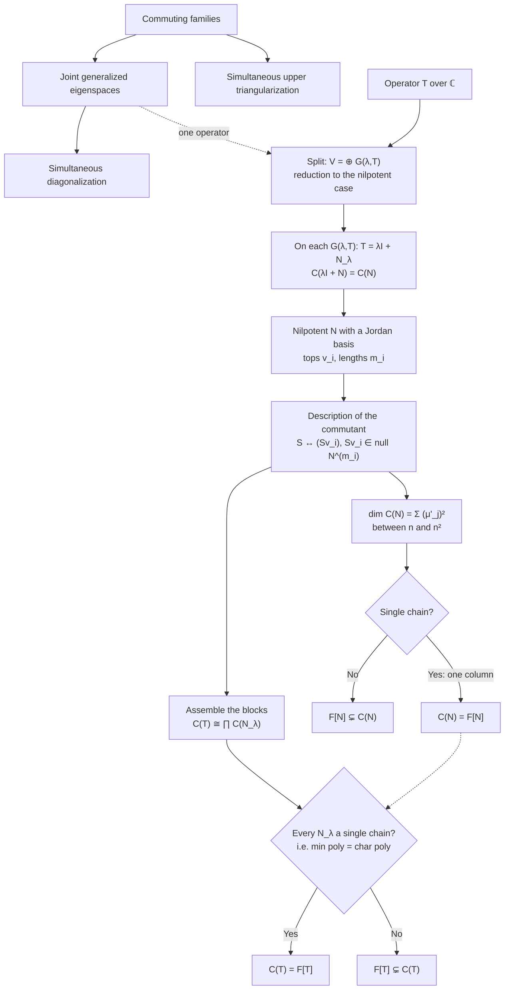

This post continues [Nilpotent Operators]() and [Eigenvalues and Eigenvectors](), and asks which operators commute with a given $T \in \mathcal{L}(V)$. The first part collects what can be said about commuting operators in general, and ends with a reduction: over $\mathbb{C}$, describing the operators that commute with $T$ comes down to the same question for a **nilpotent** operator. The second part answers that question completely using the Young diagram, and the last section carries the answer back to an arbitrary $T$.

A map of the post:

## Notation



Both $\mathcal{C}(T)$ and $\mathbf{F}[T]$ are subspaces of $\mathcal{L}(V)$, and in fact [subalgebras](https://en.wikipedia.org/wiki/Subalgebra): they are closed under composition.

{: .prompt-warning }
> $\mathbf{F}[T] \subseteq \mathcal{C}(T)$ always, since $T$ commutes with $I$ and with itself, hence with every polynomial in itself. That direction is free, and it is not the interesting one. The question this post answers is the **converse**: when is every operator commuting with $T$ a polynomial in $T$?

## Basic Facts

The smaller of the two spaces has a dimension that is easy to read off.

{: .prompt-info }
> $\dim\mathbf{F}[T] = \deg p_T$.

{: .prompt-proof }
> Let $d = \deg p_T$. *Spanning:* for $q \in \mathcal{P}(\mathbf{F})$, division gives $q = a\,p_T + r$ with $\deg r < d$, so $q(T) = r(T)$ and $I, T, \dots, T^{d-1}$ span $\mathbf{F}[T]$. *Independence:* a nontrivial relation $\sum_{t<d} c_tT^t = 0$ would be a nonzero polynomial of degree less than $d$ annihilating $T$, contradicting the minimality of $p_T$. $\blacksquare$

Shifting an operator by a scalar changes neither space.

{: .prompt-info }
> For every $\lambda \in \mathbf{F}$, $\mathcal{C}(T + \lambda I) = \mathcal{C}(T)$ and $\mathbf{F}[T + \lambda I] = \mathbf{F}[T]$.

{: .prompt-proof }
> $S(T + \lambda I) - (T + \lambda I)S = ST - TS$, so $S$ commutes with $T + \lambda I$ iff it commutes with $T$. For the second, $q(T + \lambda I) = r(T)$ with $r(z) = q(z + \lambda)$, and conversely $r(T) = q(T + \lambda I)$ with $q(z) = r(z - \lambda)$. $\blacksquare$

## Commuting Families

Call a subset $\mathcal{E} \subseteq \mathcal{L}(V)$ a **commuting family** if $ST = TS$ for all $S, T \in \mathcal{E}$. The family may be infinite. The first lemma needs only two of its members.

### Invariant Subspaces

{: .prompt-info }
> Suppose $ S,T \in \mathcal{L}(V) $ are such that $ ST = TS $. Suppose $ q \in \mathcal{P}(\mathbf{F}) $. Then
>
> $ \operatorname{null} q(S) $ and $ \operatorname{range} q(S) $ are invariant under $ T $.

{: .prompt-proof }
> $T$ commutes with every power of $S$, hence with $q(S)$. If $q(S)v = 0$, then $q(S)(Tv) = T\,q(S)v = 0$; and $T\,q(S)v = q(S)(Tv) \in \operatorname{range}q(S)$. $\blacksquare$

{: .prompt-tip }
> Special cases:
>
> * $ q(z) = z - \lambda $, then $ E(\lambda, S) $ is invariant under $ T $.
> * $ q(z) = (z - \lambda)^{\dim V} $, then $ G(\lambda, S) $ is invariant under $ T $.

### Restrictions and Quotients

Once a subspace is invariant under a whole commuting family, the family can be cut down to it, or to the quotient by it, without losing anything the proofs below need.

{: .prompt-info }
> Suppose $\mathcal{E} \subseteq \mathcal{L}(V)$ is a commuting family and $U$ is invariant under every element of $\mathcal{E}$. Then the restrictions $\left.T\right\rvert_U$ and the [quotient operators](#quotient-operator) $T/U$, for $T \in \mathcal{E}$, form commuting families, and the minimal polynomials of $\left.T\right\rvert_U$ and $T/U$ divide $p_T$.

{: .prompt-proof }
> For $T, R \in \mathcal{E}$, $u \in U$ and $x \in V$,
>
> $$(\left.T\right\rvert_U)(\left.R\right\rvert_U)u = TRu = RTu = (\left.R\right\rvert_U)(\left.T\right\rvert_U)u, \qquad (T/U)(R/U)(x+U) = TRx + U = RTx + U = (R/U)(T/U)(x+U).$$
>
> For every polynomial $q$, $q(\left.T\right\rvert_U) = \left.q(T)\right\rvert_U$ and $q(T/U)(x + U) = q(T)x + U$, so $p_T$ annihilates both operators, and a polynomial annihilating an operator is a [multiple of its minimal polynomial](#minimal-polynomial). $\blacksquare$

So restricting or passing to the quotient keeps a commuting family commuting, keeps split minimal polynomials split, and keeps diagonalizable operators diagonalizable, since the divisors of a product of distinct linear factors are again such products.

### Joint Generalized Eigenspaces

The primary decomposition extends from one operator to a commuting family. Simultaneous diagonalization will follow from it at once.

{: .prompt-info }
> Suppose $\mathcal{E} \subseteq \mathcal{L}(V)$ is a commuting family whose minimal polynomials all split. For each function $\alpha : \mathcal{E} \to \mathbf{F}$, define the **joint generalized eigenspace**
>
> $$V_\alpha = \bigcap_{T \in \mathcal{E}} G(\alpha(T), T).$$
>
> Then only finitely many $V_\alpha$ are nonzero, and
>
> $$V = \bigoplus_\alpha V_\alpha.$$
>
> Each $V_\alpha$ is invariant under every element of $\mathcal{E}$, and on it each $T \in \mathcal{E}$ is $\alpha(T)I$ plus a nilpotent operator.

{: .prompt-proof }
> *Refine.* Call a nonzero subspace invariant under every element of $\mathcal{E}$ a **block**. Start from the single block $V$. While some $S \in \mathcal{E}$ has two or more eigenvalues on some block $P$, replace $P$ by the generalized eigenspaces of $\left.S\right\rvert_P$ for those eigenvalues. They add up to $P$ because the minimal polynomial of $\left.S\right\rvert_P$ splits ([Restrictions and Quotients](#restrictions-and-quotients)), and each is a block by [Invariant Subspaces](#invariant-subspaces) applied to the commuting family of restrictions to $P$. Each step increases the number of blocks, which cannot exceed $\dim V$, so the process stops with
>
> $$V = \bigoplus_{i=1}^r P_i,$$
>
> where every $T \in \mathcal{E}$ has exactly one eigenvalue on each $P_i$; call it $\beta_i(T)$. The minimal polynomial of $\left.T\right\rvert_{P_i}$ splits with the single zero $\beta_i(T)$, so $\left.T\right\rvert_{P_i} - \beta_i(T)I$ is nilpotent.
>
> *Identify.* Fix $\alpha$ and $T$. On $P_i$, $\left.T\right\rvert_{P_i} - \alpha(T)I = (\beta_i(T) - \alpha(T))I + (\text{nilpotent})$ is nilpotent if $\beta_i(T) = \alpha(T)$ and [invertible](#inverse-of-a-jordan-block) otherwise. So by the [blockwise computation](#generalized-eigenspaces), a vector $x = \sum_i x_i$ with $x_i \in P_i$ lies in $G(\alpha(T), T)$ iff $x_i = 0$ for every $i$ with $\beta_i(T) \ne \alpha(T)$. Requiring this for every $T$ gives
>
> $$V_\alpha = \bigoplus_{i \,:\, \beta_i = \alpha} P_i.$$
>
> So $V_\alpha \ne \\{0\\}$ only when $\alpha$ is one of the finitely many $\beta_i$, each $P_i$ lies in exactly one $V_\alpha$, and $V = \bigoplus_\alpha V_\alpha$. Each $V_\alpha$ is invariant as a sum of blocks, and $T - \alpha(T)I$ is nilpotent on it because it is nilpotent on each of its $P_i$. $\blacksquare$

For a single operator this is the primary decomposition $V = \bigoplus_{\lambda \in \sigma(T)} G(\lambda, T)$.

### Simultaneous Diagonalization

A subset $\mathcal{E} \subseteq \mathcal{L}(V)$ is **simultaneously diagonalizable** if there is a basis of $V$ with respect to which every element of $\mathcal{E}$ has a diagonal matrix.

{: .prompt-info }
> Suppose every element of $\mathcal{E} \subseteq \mathcal{L}(V)$ is diagonalizable. Then $\mathcal{E}$ is simultaneously diagonalizable $\iff$ $\mathcal{E}$ is a commuting family.

{: .prompt-proof }
> ($\Rightarrow$) For $R, T \in \mathcal{E}$, the matrices $\mathcal{M}(R)$ and $\mathcal{M}(T)$ with respect to the common basis are diagonal, and diagonal matrices commute, so $\mathcal{M}(RT) = \mathcal{M}(R)\mathcal{M}(T) = \mathcal{M}(T)\mathcal{M}(R) = \mathcal{M}(TR)$ and $RT = TR$.
>
> ($\Leftarrow$) Suppose $\mathcal{E}$ is a commuting family. A diagonalizable operator's minimal polynomial is a [product of distinct linear factors](#generalized-eigenspaces), so it splits, and [Joint Generalized Eigenspaces](#joint-generalized-eigenspaces) gives $V = \bigoplus_\alpha V_\alpha$. Fix $\alpha$ with $V_\alpha \ne \\{0\\}$ and $T \in \mathcal{E}$. By [Restrictions and Quotients](#restrictions-and-quotients), the minimal polynomial of $\left.T\right\rvert_{V_\alpha}$ divides $p_T$, so it is again a product of distinct linear factors. Its zeros are the eigenvalues of $\left.T\right\rvert_{V_\alpha}$, and the only one is $\alpha(T)$, since $\left.T\right\rvert_{V_\alpha} - \alpha(T)I$ is nilpotent. So the minimal polynomial is $z - \alpha(T)$, and $\left.T\right\rvert_{V_\alpha} = \alpha(T)I$.
>
> So every nonzero vector of $V_\alpha$ is an eigenvector of every element of $\mathcal{E}$. Concatenating bases of the nonzero $V_\alpha$ gives a basis of $V$ made of common eigenvectors, with respect to which every element of $\mathcal{E}$ has a diagonal matrix. $\blacksquare$

### Simultaneous Upper Triangularization

Without diagonalizability, commuting operators can still be triangularized together, as long as each one can be triangularized on its own. A subset $\mathcal{E} \subseteq \mathcal{L}(V)$ is **simultaneously upper-triangularizable** if there is a basis of $V$ with respect to which every element of $\mathcal{E}$ has an upper-triangular matrix.

{: .prompt-info }
> Suppose $V$ is nonzero and $\mathcal{E} \subseteq \mathcal{L}(V)$ is a commuting family whose minimal polynomials all split over $\mathbf{F}$ (automatic when $\mathbf{F} = \mathbb{C}$). Then $\mathcal{E}$ is simultaneously upper-triangularizable.

{: .prompt-proof }
> Induct on $n = \dim V$; the case $n = 1$ is trivial. By [Restrictions and Quotients](#restrictions-and-quotients), restricting to a subspace invariant under all of $\mathcal{E}$, or passing to the quotient by one, gives a commuting family whose minimal polynomials still split, so the induction hypothesis applies to it.
>
> *A common eigenvector.* Like the refinement in [Joint Generalized Eigenspaces](#joint-generalized-eigenspaces), this step splits off an eigenspace of a non-scalar $S$, but keeps only one of them. If every element of $\mathcal{E}$ is a scalar multiple of $I$, any nonzero $v_1$ is an eigenvector of all of them. Otherwise pick $S \in \mathcal{E}$ that is not. Its minimal polynomial splits and has positive degree, so $S$ has an eigenvalue $\lambda$, and $W = E(\lambda, S)$ is nonzero, not all of $V$ since $S \ne \lambda I$, and invariant under every element of $\mathcal{E}$ by [Invariant Subspaces](#invariant-subspaces), since each element commutes with $S$. By the induction hypothesis, $W$ has a basis making every restriction to $W$ upper triangular. Its first vector $v_1$ is an eigenvector of every restriction, since the first column of an upper-triangular matrix is zero below the diagonal, hence of every element of $\mathcal{E}$.
>
> *The remaining vectors.* Let $U = \operatorname{span}(v_1)$, which is invariant under every $T \in \mathcal{E}$. By the induction hypothesis, $V/U$ has a basis $v_2 + U, \dots, v_n + U$ making every $T/U$ upper triangular. Each $v_j + U$ is nonzero, so $v_j \notin U = \operatorname{span}(v_1)$ for $j \ge 2$; by [Block Matrix](#block-matrix), the whole list $v_1, v_2, \dots, v_n$ is a basis of $V$, and with respect to it every $T \in \mathcal{E}$ has matrix
>
> $$\mathcal{M}(T) = \begin{pmatrix} c_T & \ast \\ 0 & \mathcal{M}(T/U) \end{pmatrix},$$
>
> where $\mathcal{M}(\left.T\right\rvert_U) = (c_T)$ is $1 \times 1$ because $Tv_1 = c_Tv_1$. Since $\mathcal{M}(T/U)$ is upper triangular, so is $\mathcal{M}(T)$. $\blacksquare$

A single operator is upper-triangularizable [iff its minimal polynomial splits](#the-hierarchy-of-normal-forms), so the hypothesis cannot be weakened: a commuting family is simultaneously upper-triangularizable iff each member is upper-triangularizable on its own.

In particular, a commuting family with split minimal polynomials has a **common eigenvector**: the first vector of such a basis, since $Tv_1 \in \operatorname{span}(v_1)$ for every $T \in \mathcal{E}$.

{: .prompt-tip }
> Only diagonalization comes with a converse. Diagonal matrices commute, so a common diagonal basis forces commuting; upper-triangular matrices generally do not commute, so a common triangular basis forces nothing.
>
> Jordan form does not pass to commuting families. Let $N$ be a single chain on $\mathbf{F}^3$, which commutes with $N^2$. The only Jordan form of $N$ is $J_3(0)$, so any Jordan basis $b_1, b_2, b_3$ for $N$ has $Nb_3 = b_2$, $Nb_2 = b_1$, $Nb_1 = 0$. In it $N^2b_3 = b_1$, a $1$ in the top-right corner, which is not a Jordan matrix. So $N$ and $N^2$ have no common Jordan basis.

## Reduction to the Nilpotent Case

The results above concern commuting families. To describe the commutant of a single
operator, the first move is to break $V$ into generalized eigenspaces, on each of which the
operator is a scalar plus a nilpotent.

{: .prompt-info }
> Suppose $\mathbf{F} = \mathbb{C}$. For each $\lambda \in \sigma(T)$ write $G_\lambda = G(\lambda, T)$, so that $V = \bigoplus_{\lambda \in \sigma(T)} G_\lambda$, and let $N_\lambda = \left.(T - \lambda I)\right\rvert_{G_\lambda}$, which is nilpotent. For $S$ leaving every $G_\lambda$ invariant, let
>
> $$\Psi(S) = \big(\left.S\right\rvert_{G_\lambda}\big)_{\lambda \in \sigma(T)}.$$
>
> (a) $ST = TS \iff$ each $G_\lambda$ is invariant under $S$ **and** $\left. S \right\rvert_{G_\lambda}$ commutes with $N_\lambda$.
>
> (b) $\Psi$ is an isomorphism
>
> $$\mathcal{C}(T) \;\cong\; \prod_{\lambda \in \sigma(T)} \mathcal{C}(N_\lambda), \qquad \text{so} \qquad \dim\mathcal{C}(T) = \sum_{\lambda \in \sigma(T)} \dim\mathcal{C}(N_\lambda).$$
>
> (c) $\Psi$ restricts to an isomorphism
>
> $$\mathbf{F}[T] \;\cong\; \prod_{\lambda \in \sigma(T)} \mathbf{F}[N_\lambda].$$

{: .prompt-proof }
> (a) ($\Rightarrow$) $G_\lambda = \operatorname{null}(T - \lambda I)^n$ is invariant under $S$ by [Invariant Subspaces](#invariant-subspaces), with the roles of $S$ and $T$ swapped. Restricting $ST = TS$ to $G_\lambda$ and subtracting $\lambda \left.S\right\rvert_{G_\lambda}$ from both sides gives $\left.S\right\rvert_{G_\lambda}N_\lambda = N_\lambda\left.S\right\rvert_{G_\lambda}$.
>
> ($\Leftarrow$) $\left.S\right\rvert_{G_\lambda}$ commutes with $N_\lambda + \lambda I = \left.T\right\rvert_{G_\lambda}$, so $STv = TSv$ for $v$ in each $G_\lambda$, hence for every $v \in V$.
>
> (b) By (a), $\Psi$ maps $\mathcal{C}(T)$ into the product. It is linear. It is injective: if $\Psi(S) = 0$, then $S$ is $0$ on every $G_\lambda$, and every $v \in V$ is a sum of vectors from the $G_\lambda$, so $S = 0$. For surjectivity, given $R = (R_\lambda)$ with $R_\lambda \in \mathcal{C}(N_\lambda)$, define $S_R$ componentwise: write each $v \in V$ uniquely as $v = \sum_\lambda v_\lambda$ with $v_\lambda \in G_\lambda$, and set $S_Rv = \sum_\lambda R_\lambda v_\lambda$. For $v \in G_\lambda$ this gives $S_Rv = R_\lambda v \in G_\lambda$, so each $G_\lambda$ is $S_R$-invariant with $\left.S_R\right\rvert_{G_\lambda} = R_\lambda$, and $S_R \in \mathcal{C}(T)$ by (a), and $\Psi(S_R) = R$.
>
> (c) For every polynomial $q$, $\left.q(T)\right\rvert_{G_\lambda} = q(\lambda I + N_\lambda)$, which lies in $\mathbf{F}[\lambda I + N_\lambda] = \mathbf{F}[N_\lambda]$ by [shift invariance](#basic-facts). So $\Psi$ maps $\mathbf{F}[T]$ into $\prod_\lambda \mathbf{F}[N_\lambda]$, injectively by (b). Write $p_T = \prod_\lambda (z - \lambda)^{e_\lambda}$. The exponent $e_\lambda$ is the [index of nilpotency of $N_\lambda$](#the-nilpotent-part), so the minimal polynomial of $N_\lambda$ is $z^{e_\lambda}$. Since [$\dim\mathbf{F}[T] = \deg p_T$](#basic-facts), both sides have dimension $\sum_\lambda e_\lambda$, and an injective linear map between spaces of the same finite dimension is an isomorphism. $\blacksquare$

{: .prompt-tip }
> By [shift invariance](#basic-facts), $\mathcal{C}(\left.T\right\rvert_{G_\lambda}) = \mathcal{C}(\lambda I + N_\lambda) = \mathcal{C}(N_\lambda)$. **Everything below therefore takes $N$ nilpotent, with no loss**; [Back to Arbitrary Operators](#back-to-arbitrary-operators) assembles the blocks.

{: .prompt-tip }
> (c) is a Chinese remainder theorem for operators: choose a polynomial in $N_\lambda$ independently for each eigenvalue, and a single polynomial in $T$ realizes all the choices at once. Choosing $I$ on one $G_\lambda$ and $0$ on the others recovers the fact that the [projections onto the generalized eigenspaces are polynomials in $T$](#the-nilpotent-part).

## The Commutant of a Nilpotent Operator

From here on $N \in \mathcal{L}(V)$ is nilpotent, with a Jordan basis of tops $v_1, \dots, v_k$ and lengths $m_1 \ge \dots \ge m_k$, so the vectors $N^jv_i$ with $0 \le j \le m_i - 1$ form a basis of $V$.

### Description of the Commutant

Unlike the generalized eigenspaces in the [reduction](#reduction-to-the-nilpotent-case), the Jordan chains are not preserved by commuting operators (see [below](#commuting-operators-need-not-preserve-chains)), so the commutant cannot be split chain by chain. Instead, a commuting operator is pinned down by where it sends the $k$ tops, and each top may go anywhere killed by the right power of $N$.

{: .prompt-info }
> The map
>
> $$\Phi : \mathcal{C}(N) \to \operatorname{null}N^{m_1} \times \dots \times \operatorname{null}N^{m_k}, \qquad \Phi(S) = (Sv_1,\dots,Sv_k)$$
>
> is an isomorphism. Its inverse sends $w = (w_1, \dots, w_k)$ to the operator $S_w$ defined on the Jordan basis by
>
> $$S_w(N^jv_i) := N^j w_i, \qquad 0 \le j \le m_i - 1.$$

{: .prompt-proof }
> *Into the product.* If $SN = NS$, then $SN^j = N^jS$ for all $j$. Since $N^{m_i}v_i = 0$,
>
> $$0 = S(N^{m_i}v_i) = N^{m_i}(Sv_i),$$
>
> so $Sv_i \in \operatorname{null}N^{m_i}$. $\Phi$ is clearly linear.
>
> *Injective.* Suppose $\Phi(S) = 0$, i.e. $Sv_1 = \dots = Sv_k = 0$. Then on every basis vector $S(N^jv_i) = N^j(Sv_i) = 0$, so $S = 0$.
>
> *Surjective.* Given $w = (w_1, \dots, w_k)$ with $w_i \in \operatorname{null}N^{m_i}$, define $S_w$ as in the statement. Taking $j = 0$ gives $S_wv_i = w_i$, so $\Phi(S_w) = w$ once $S_w \in \mathcal{C}(N)$. Check $S_wN = NS_w$ on a basis vector $N^jv_i$:
>
> - If $j < m_i - 1$: $\;S_wN(N^jv_i) = S_w(N^{j+1}v_i) = N^{j+1}w_i$, while $NS_w(N^jv_i) = N(N^jw_i) = N^{j+1}w_i$. Equal.
> - If $j = m_i-1$ (bottom of the chain): $\;S_wN(N^{m_i-1}v_i) = S_w(0) = 0$, while $NS_w(N^{m_i-1}v_i) = N^{m_i}w_i = 0$ by the constraint. $\blacksquare$

In practice: find a Jordan basis, choose each $w_i$ in $\operatorname{null}N^{m_i}$, and extend by $S_w(N^jv_i) := N^jw_i$. Every commuting operator arises this way, exactly once.

The invertible elements of $\mathcal{C}(N)$ stay invertible when $N$ is added, with an explicit inverse; see [Invertible Plus Nilpotent](#invertible-plus-nilpotent).

### Dimension

Recall from [Nilpotent Operators](#jordan-basis) that $d_m = \dim\operatorname{null}N^m = \sum_j \min(m, m_j)$: $\operatorname{null}N^m$ is spanned by the bottom $\min(m, m_j)$ vectors of every chain $j$.

{: .prompt-info }
> $$\dim\mathcal{C}(N) = \sum_{i,j}\min(m_i,m_j) = \sum_l \left(\mu'_l\right)^2.$$

{: .prompt-proof }
> By the [description](#description-of-the-commutant), $\dim\mathcal{C}(N) = \sum_i d_{m_i} = \sum_{i,j}\min(m_i, m_j)$. Writing $\min(m_i,m_j) = \\#\\{l : l \le m_i \text{ and } l \le m_j\\}$ turns the double sum into a count of triples $(i,j,l)$:
>
> $$\sum_{i,j}\min(m_i,m_j) \;=\; \sum_{l \ge 1}\#\{i : m_i \ge l\}\cdot\#\{j : m_j \ge l\} \;=\; \sum_{l\ge1}\left(\mu'_l\right)^2. \qquad \blacksquare$$

Here are the windows $\operatorname{null}N^{m_i}$ for $\mu = (3,2,1)$:

So $\dim\mathcal{C}(N)$ is the sum of squares of the level sizes: the commutant is large when the diagram is short and wide, with many chains of similar length, and small when it is tall and thin. The extremes are as far apart as they could be.

{: .prompt-info }
> For every nilpotent $N$ on $V$ with $\dim V = n$,
>
> $$n \;\le\; \dim\mathcal{C}(N) \;\le\; n^2,$$
>
> with equality on the left exactly when the diagram is a single column ($k = 1$), and on the right exactly when it is a single level ($N = 0$).

{: .prompt-proof }
> Since each nonzero $\mu'_l$ is at least $1$,
>
> $$\sum_l (\mu'_l)^2 \;\ge\; \sum_l \mu'_l \;=\; n,$$
>
> with equality iff every level has size $1$, i.e. $k = \mu'_1 = 1$. And since all terms are non-negative,
>
> $$\sum_l (\mu'_l)^2 \;\le\; \left(\sum_l \mu'_l\right)^2 \;=\; n^2,$$
>
> with equality iff only one term is nonzero, i.e. $p = 1$ and $N = 0$. $\blacksquare$

The [two extremes](#two-extremes) are worked out below.

### Commuting Operators Need Not Preserve Chains

{: .prompt-warning }
> Nothing in the description of the commutant says $Sv_i$ has to lie in chain $i$. The constraint space $\operatorname{null}N^{m_i}$ is not a subspace of chain $i$: it is spanned by the bottom $\min(m_i, m_j)$ vectors of **every** chain $j$, so it reaches across the whole array. When all lengths equal $p$, $\operatorname{null}N^{m_i} = \operatorname{null}N^p = V$ and there is no constraint whatsoever.

**Swapping chains.** Take $\mathbf{F}^4$ with two chains of length $2$:

$$e_2 \mapsto e_1 \mapsto 0, \qquad e_4 \mapsto e_3 \mapsto 0.$$

Here $N^2 = 0$, so both constraints read $w_i \in \mathbf{F}^4$ and any pair of tops is legal. Swapping the chains is the choice $w_1 = e_4$, $w_2 = e_2$, which forces

$$Se_2 = e_4, \quad Se_1 = Ne_4 = e_3, \qquad Se_4 = e_2, \quad Se_3 = Ne_2 = e_1.$$

The construction guarantees $SN = NS$; as a spot-check, $SNe_2 = Se_1 = e_3$ and $NSe_2 = Ne_4 = e_3$. So $S$ commutes with $N$ while carrying chain $1$ onto chain $2$.

**Shearing.** Take $w_1 = e_2 + e_4$ and $w_2 = e_4$ instead, giving

$$Se_2 = e_2 + e_4, \quad Se_1 = e_1 + e_3, \qquad Se_4 = e_4, \quad Se_3 = e_3.$$

This blends chain $1$ into chain $2$ without being a permutation of the basis.

**No constraint at all.** For $N = 0$ on $\mathbf{F}^2$, two chains of length $1$, every operator commutes, so the commutant is all of $\mathcal{L}(\mathbf{F}^2)$, of dimension $4$. The ones preserving the chain $\operatorname{span}(e_1)$ are the upper triangular matrices, a proper subspace of dimension $3$. Preserving a chosen chain is a genuine restriction that most commuting operators fail.

**Unequal lengths.** This is where the constraint bites. Take $\mathbf{F}^3$ with chains

$$e_2 \mapsto e_1 \mapsto 0, \qquad f \mapsto 0,$$

so $m_1 = 2$ and $m_2 = 1$. The top of the long chain is unconstrained, since $\operatorname{null}N^2 = \mathbf{F}^3$, so $Se_2$ may be $f$. But the top of the short chain satisfies $Sf \in \operatorname{null}N = \operatorname{span}(e_1, f)$, so $Sf$ cannot be $e_2$: a short chain can only be sent into the bottom portion of a longer one, never onto its top. The freedom is **asymmetric**, and $\min(m_i, m_j)$ is exactly the bookkeeping for it.

**Worked example**

Take $N = \partial/\partial x$ on $V = \operatorname{span}(1,x,y,x^2,xy)$, with the Jordan basis [found in Nilpotent Operators](#find-a-jordan-basis): chain $x^2 \mapsto 2x \mapsto 2$ and chain $xy \mapsto y$. So $v_1 = x^2$ with $m_1 = 3$, and $v_2 = xy$ with $m_2 = 2$.

Constraints: $w_1 \in \operatorname{null}N^3 = V$, unrestricted; $w_2 \in \operatorname{null}N^2 = \operatorname{span}(1,y,x,xy)$. The asymmetry is visible: $w_1$ may be $xy$, but $w_2$ may **not** be $x^2$, since $N^2x^2 = 2 \neq 0$.

Choose $w_1 = xy$ and $w_2 = 2x$. Then

$$S(x^2) = xy, \quad S(2x) = N(xy) = y, \quad S(2) = N^2(xy) = 0,$$
$$S(xy) = 2x, \quad S(y) = N(2x) = 2.$$

Spot-check: $SN(x^2) = S(2x) = y$ and $NS(x^2) = N(xy) = y$; also $SN(xy) = S(y) = 2$ and $NS(xy) = N(2x) = 2$.

Dimension check: $\dim\operatorname{null}N^3 + \dim\operatorname{null}N^2 = 5 + 4 = 9$, agreeing with $\sum_{i,j}\min(m_i,m_j) = 3+2+2+2$ and with $\sum_l(\mu'_l)^2 = 4 + 4 + 1$, out of $25$ for all of $\mathcal{L}(V)$.

The isomorphism also gives a **basis** of the commutant for free: run over a basis of $\operatorname{null}N^{m_i}$ for one index with the other $w$'s set to $0$. Here that gives $5 + 4 = 9$ explicit commuting operators spanning the commutant.

**Exercise**

{: .prompt-info }
> Give an example of two commuting operators $S,T$ on $\mathbf{F}^4$ such that there is a subspace of $\mathbf{F}^4$ that is invariant under $S$ but not under $T$ and there is a subspace of $\mathbf{F}^4$ that is invariant under $T$ but not under $S$.

Take the two chains of length $2$ and the chain swap $S$ from [Swapping chains](#commuting-operators-need-not-preserve-chains) above, so $SN = NS$. Then

- $\operatorname{span}(e_1)$ is $N$-invariant, since $Ne_1 = 0$, but not $S$-invariant, since $Se_1 = e_3$;
- $\operatorname{span}(e_2+e_4)$ is $S$-invariant, since $S(e_2+e_4) = e_2+e_4$, but not $N$-invariant, since $N(e_2+e_4) = e_1+e_3$.

Contrast [Invariant Subspaces](#invariant-subspaces): commuting operators share every subspace of the form $\operatorname{null}q(S)$ or $\operatorname{range}q(S)$, but not invariant subspaces in general.

### Two Extremes

[Nilpotent Operators](#two-extremes) singles out two shapes. **One column**, $\mu = (n)$ and $\mu' = (1^n)$, is a single
chain. **One level**, $\mu = (1^n)$ and $\mu' = (n)$, is the zero operator. They are conjugate
partitions, and they are the two equality cases of $n \le \dim\mathcal{C}(N) \le n^2$: one commutant
is as small as it can be, the other as large.

#### One Column: a Single Chain

If $k = 1$, the single chain has length $m_1 = n$, so $\operatorname{null}N^n = V$, so there is no constraint at all and $S$ is determined by an arbitrary $w = Sv$. Since $k = 1$, the chain

$$v,\; Nv,\; \dots,\; N^{n-1}v$$

is a basis of $V$, so expand $w$ in it:

$$w = c_0v + c_1Nv + \dots + c_{n-1}N^{n-1}v = q(N)v, \qquad q(z) = c_0 + c_1z + \dots + c_{n-1}z^{n-1}.$$

Now compare $S$ with $q(N)$ on each basis vector $N^tv$, for $0 \le t \le n-1$:

$$S(N^tv) \;=\; N^t(Sv) \;=\; N^t\big(q(N)v\big) \;=\; q(N)(N^tv).$$

The first equality is $SN^t = N^tS$, from $SN = NS$. The second substitutes $Sv = w = q(N)v$. The third is $N^tq(N) = q(N)N^t$, since polynomials in $N$ commute with powers of $N$.

So $S$ and $q(N)$ agree on a basis of $V$, hence are equal as operators:

$$S = c_0I + c_1N + \dots + c_{n-1}N^{n-1}.$$

In the basis $(N^{n-1}v,\dots,Nv,v)$, $N$ is $J_n(0)$ and $N^t$ is the band of $1$s on the $t$-th superdiagonal ([Nilpotent Block](#nilpotent-block)), so $S$ has $c_t$ on the $t$-th superdiagonal: upper-triangular Toeplitz, the same shape as the powers of $J_n(\lambda)$ in [Non-nilpotent Block](#non-nilpotent-block). For $n = 3$, with $e_3 \mapsto e_2 \mapsto e_1 \mapsto 0$ and $Se_3 = w = ae_1 + be_2 + ce_3$,

$$N = \begin{pmatrix} 0&1&0\\ 0&0&1\\ 0&0&0\end{pmatrix}, \qquad S = \begin{pmatrix} c&b&a\\ 0&c&b\\ 0&0&c\end{pmatrix} = cI + bN + aN^2.$$

{: .prompt-info }
> For $N$ nilpotent with $k$ chains,
>
> $$\mathcal{C}(N) = \mathbf{F}[N] \iff k = 1,$$
>
> that is, iff $N$ has a single Jordan block, equivalently $\dim\operatorname{null}N = 1$.

{: .prompt-proof }
> ($\Leftarrow$) is the computation above.
>
> ($\Rightarrow$) The minimal polynomial of $N$ is $z^p$, so $\dim\mathbf{F}[N] = p$. If $k \ge 2$, then $n = \sum_i m_i > m_1 = p$, since the omitted lengths are positive, so by the [lower bound](#dimension)
>
> $$\dim\mathcal{C}(N) \ \ge\ n \ >\ p \ =\ \dim\mathbf{F}[N]$$
>
> and the inclusion $\mathbf{F}[N] \subseteq \mathcal{C}(N)$ is strict. $\blacksquare$

#### One Level: the Zero Operator

The opposite shape is $N = 0$, where every chain has length $1$. Now the constraint
$w_i \in \operatorname{null}N^{m_i}$ reads $w_i \in \operatorname{null}N = V$ for every $i$, so
there is no constraint at all and *every* operator commutes:

$$\mathcal{C}(0) = \mathcal{L}(V), \qquad \dim\mathcal{C}(0) = n^2.$$

Meanwhile $N^1 = 0$ already, so $p = 1$ and $\mathbf{F}[N] = \\{c I : c \in \mathbf{F}\\}$ is just
the scalars, of dimension $1$. This is the failure of $\mathcal{C}(N) = \mathbf{F}[N]$ at its
most extreme: $n^2$ against $1$.

#### Comparing the Ends

|                                   | one column | one level          |
| --------------------------------- | ---------- | ------------------ |
| $\mu$                             | $(n)$      | $(1^n)$            |
| $\mu'$                            | $(1^n)$    | $(n)$              |
| $\dim\mathcal{C}(N)$              | $n$        | $n^2$              |
| $\dim\mathbf{F}[N] = p$           | $n$        | $1$                |
| $\mathcal{C}(N) = \mathbf{F}[N]$? | yes        | no, unless $n = 1$ |

{: .prompt-tip }
> *Why the commutant measures how non-unique a Jordan basis is.*
>
> Fix a Jordan basis with tops $v_i$, and take another Jordan basis of the same shape, with tops $v'_i$. Each $v'_i$ lies in $\operatorname{null}N^{m_i}$, so the [description of the commutant](#description-of-the-commutant) gives $S = S_w \in \mathcal{C}(N)$ for $w = (v'_1, \dots, v'_k)$, with $S(N^jv_i) = N^jv'_i$. So $S$ carries the first basis onto the second, and because it maps a basis onto a basis, it is invertible. It is the only element of $\mathcal{C}(N)$ doing so, since $\Phi$ is injective.
>
> Conversely, take any invertible $S \in \mathcal{C}(N)$. Then $S(N^jv_i) = N^j(Sv_i)$, so $S$ sends the chains of the first basis to chains with tops $Sv_i$ and the same lengths, and these form a basis because $S$ is invertible: another Jordan basis of the same shape. A non-invertible element of $\mathcal{C}(N)$ would send the basis to a dependent list instead, so invertibility is exactly the condition needed.
>
> So, once one Jordan basis is fixed, the Jordan bases of that shape correspond one-to-one to the invertible elements of $\mathcal{C}(N)$. (In group language, these invertible elements form a group under composition that acts *simply transitively* on the Jordan bases of the shape.) The invertible elements are the points of $\mathcal{C}(N)$ where the determinant does not vanish, a nonempty open subset, so they have dimension $\dim\mathcal{C}(N)$. That is the dimension of the choice available, and it is where the counts in [Nilpotent Operators](#two-extremes) came from: every basis of $V$ when $N = 0$ ($n^2$ worth of freedom), and only the choice of a top when $k = 1$ ($n$ worth).
>
> The complementary count is just as clean. The operators similar to $N$ form a set of dimension
>
> $$\dim\mathcal{L}(V) - \dim\mathcal{C}(N) \;=\; n^2 - \sum_j (\mu'_j)^2 .$$
>
> Freedom in the basis and size of the similarity class always sum to $n^2$. For $N = 0$ the
> class is a single point, since nothing is similar to the zero operator but itself; for a
> single chain it is $n^2 - n$, as large as a nilpotent operator's class can be.

## Back to Arbitrary Operators

Over $\mathbb{C}$, the commutant of an arbitrary $T$ is found in three steps.

1. **Split.** Write $V = \bigoplus_{\lambda \in \sigma(T)} G_\lambda$. By the [reduction](#reduction-to-the-nilpotent-case), a commuting operator preserves each $G_\lambda$, and on $G_\lambda$ commuting with $\left.T\right\rvert_{G_\lambda} = \lambda I + N_\lambda$ is the same as commuting with $N_\lambda$.
2. **Solve each block.** Choose $R_\lambda \in \mathcal{C}(N_\lambda)$ by the [description of the commutant](#description-of-the-commutant): pick where the tops of a Jordan basis of $N_\lambda$ go.
3. **Assemble.** The operator $S_R$ acting as $R_\lambda$ on each $G_\lambda$ is the general element of $\mathcal{C}(T)$. In a basis made of bases of the $G_\lambda$, its matrix is block diagonal, with one block per eigenvalue.

**Example**

Take $T = \operatorname{diag}(2, 2, 5)$ on $\mathbf{F}^3$. Then $G_2 = \operatorname{span}(e_1, e_2)$ with $N_2 = 0$, so $R_2$ is any operator on $G_2$; and $G_5 = \operatorname{span}(e_3)$, so $R_5$ is any scalar. Hence

$$\mathcal{C}(T) = \left\{\begin{pmatrix} a&b&0\\ c&d&0\\ 0&0&e \end{pmatrix} : a,b,c,d,e \in \mathbf{F}\right\}, \qquad \dim\mathcal{C}(T) = 5,$$

while $p_T = (z-2)(z-5)$ gives $\dim\mathbf{F}[T] = 2$. So $\mathbf{F}[T] \subsetneq \mathcal{C}(T)$: here $N_2 = 0$ has two chains rather than one.

In general, with $\mu^{(\lambda)}$ the diagram of $N_\lambda$,

$$\dim\mathcal{C}(T) = \sum_{\lambda \in \sigma(T)} \dim\mathcal{C}(N_\lambda) = \sum_{\lambda \in \sigma(T)} \sum_l \left(\mu^{(\lambda)\prime}_l\right)^2.$$

The question from the start of the post now has a complete answer.

{: .prompt-info }
> Suppose $\mathbf{F} = \mathbb{C}$. Then $\mathcal{C}(T) = \mathbf{F}[T]$ iff the minimal and characteristic polynomials of $T$ coincide.

{: .prompt-proof }
> By (b) and (c) of the [reduction](#reduction-to-the-nilpotent-case), $\Psi$ is injective on $\mathcal{C}(T)$ and carries $\mathcal{C}(T)$ onto $\prod_\lambda \mathcal{C}(N_\lambda)$ and $\mathbf{F}[T]$ onto $\prod_\lambda \mathbf{F}[N_\lambda]$. So $\mathcal{C}(T) = \mathbf{F}[T]$ iff $\mathcal{C}(N_\lambda) = \mathbf{F}[N_\lambda]$ for every $\lambda$, iff every $N_\lambda$ is a single chain, by the [One Column](#one-column-a-single-chain) theorem.
>
> Finally, the exponents of $z - \lambda$ in the characteristic and minimal polynomials are the [number of boxes and the height of the tallest column](#the-nilpotent-part) of the diagram of $N_\lambda$, which are equal iff that diagram is a single column. So the two polynomials coincide iff every $N_\lambda$ is a single chain. $\blacksquare$

{: .prompt-tip }
> The minimal and characteristic polynomials coincide iff $T$ is [cyclic](#one-column-a-single-chain). For cyclic $T$, the [One Column](#one-column-a-single-chain) computation also gives $\mathcal{C}(T) = \mathbf{F}[T]$ directly, with $T$ in place of $N$: write $Sv = q(T)v$, then $S(T^jv) = T^jq(T)v = q(T)(T^jv)$, so $S = q(T)$.
