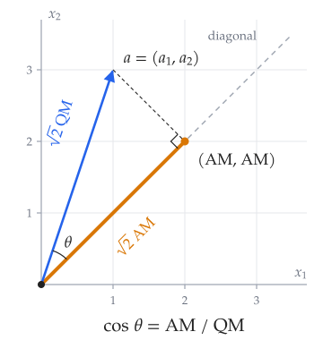
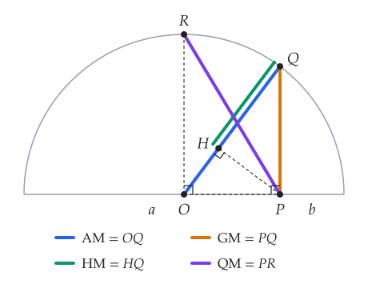
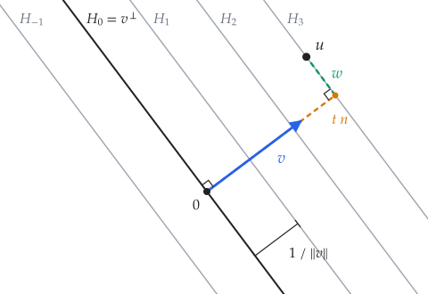
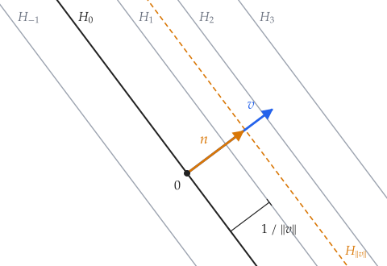
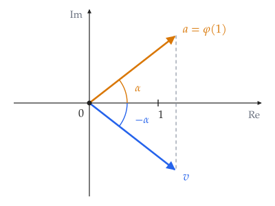

Notes on inner products: the definition over $\mathbb{R}$ and $\mathbb{C}$, the parallelogram equality and which norms come from an inner product, and two applications of the Cauchy–Schwarz inequality: the classical mean inequalities and a bound on eigenvalues, a characterization of orthonormal lists by norms, and the Riesz representation theorem.

## Notation



## Inner Products

An **inner product** on $V$ is

- over $\mathbb{R}$: a positive-definite symmetric bilinear form;
- over $\mathbb{C}$: a positive-definite Hermitian form.

It defines the norm $\lVert v \rVert = \sqrt{\langle v, v \rangle}$.

### The Parallelogram Equality

{: .prompt-info }
> In an inner product space, for all $u, v \in V$,
>
> $$\lVert u + v \rVert^2 + \lVert u - v \rVert^2 = 2\big(\lVert u \rVert^2 + \lVert v \rVert^2\big).$$

{: .prompt-proof }
> Expanding gives $\lVert u \pm v \rVert^2 = \lVert u \rVert^2 \pm 2\operatorname{Re}\langle u, v \rangle + \lVert v \rVert^2$. Adding the two cancels the cross terms. $\blacksquare$

{: .prompt-info }
> [*Polarization identities.*](https://en.wikipedia.org/wiki/Polarization_identity) In an inner product space, the norm determines the inner product: for all $u, v \in V$,
>
> $$\langle u, v \rangle = \frac{\lVert u + v \rVert^2 - \lVert u - v \rVert^2}{4} \quad \text{over } \mathbb{R},$$
>
> $$\langle u, v \rangle = \frac{\lVert u + v \rVert^2 - \lVert u - v \rVert^2 + \lVert u + iv \rVert^2\, i - \lVert u - iv \rVert^2\, i}{4} \quad \text{over } \mathbb{C}.$$

{: .prompt-proof }
> Subtracting the two expansions in the previous proof gives $\lVert u + v \rVert^2 - \lVert u - v \rVert^2 = 4\operatorname{Re}\langle u, v \rangle$, which is the real case. Over $\mathbb{C}$, replacing $v$ by $iv$ and using $\operatorname{Re}\langle u, iv \rangle = \operatorname{Re}\big(\overline{i}\langle u, v \rangle\big) = \operatorname{Im}\langle u, v \rangle$ gives $\lVert u + iv \rVert^2 - \lVert u - iv \rVert^2 = 4\operatorname{Im}\langle u, v \rangle$. So the right side is $\operatorname{Re}\langle u, v \rangle + i\operatorname{Im}\langle u, v \rangle$. $\blacksquare$

A **norm** on $V$ is a function $\lVert \cdot \rVert : V \to [0, \infty)$ such that

- $\lVert v \rVert = 0$ if and only if $v = 0$;
- $\lVert \alpha v \rVert = \lvert \alpha \rvert\,\lVert v \rVert$ for all $\alpha \in \mathbf{F}$ and all $v \in V$;
- $\lVert u + v \rVert \le \lVert u \rVert + \lVert v \rVert$ for all $u, v \in V$.

A norm **comes from an inner product** if there is an inner product $\langle \cdot, \cdot \rangle$ on $V$ such that $\lVert v \rVert = \langle v, v \rangle^{1/2}$ for all $v \in V$.

{: .prompt-info }
> *Jordan–von Neumann theorem.* A norm on $V$ comes from an inner product if and only if it satisfies the parallelogram equality. The inner product is then given by the polarization identities.

{: .prompt-proof }
> *($\Rightarrow$)* The two boxes above.
>
> *($\Leftarrow$)* Define $\langle \cdot, \cdot \rangle$ by the polarization identity and check that it is an inner product. Write $R(u, v) = \frac14\big(\lVert u + v \rVert^2 - \lVert u - v \rVert^2\big)$.
>
> *Real case.* $R$ is symmetric, $R(-u, v) = -R(u, v)$, and $R(v, v) = \lVert v \rVert^2$. Apply the parallelogram equality to $x + v, y + v$ and to $x - v, y - v$, and subtract:
>
> $$R(x + y, 2v) = 2R(x, v) + 2R(y, v).$$
>
> With $y = 0$ this gives $R(x, 2v) = 2R(x, v)$, so the left side is $2R(x + y, v)$, and $R$ is additive in the first slot. Additivity gives $R(qu, v) = qR(u, v)$ for rational $q$, and continuity of the norm ($\big\lvert \lVert a \rVert - \lVert b \rVert \big\rvert \le \lVert a - b \rVert$) extends this to real $q$.
>
> *Complex case.* $R$ is a real inner product on $V$ viewed as a real vector space, and $\langle u, v \rangle = R(u, v) + iR(u, iv)$. Since $\lVert iw \rVert = \lVert w \rVert$, $R(iu, iv) = R(u, v)$. Hence $R(iu, v) = R(-u, iv) = -R(u, iv)$, and $R(v, iv) = R(iv, -v) = -R(v, iv)$, so $R(v, iv) = 0$. These give $\langle iu, v \rangle = i\langle u, v \rangle$, $\langle v, u \rangle = \overline{\langle u, v \rangle}$, and $\langle v, v \rangle = \lVert v \rVert^2$. $\blacksquare$

### Which $p$-Norms Come from an Inner Product

{: .prompt-info }
> Suppose $p > 0$ and $n \ge 2$. There is an inner product on $\mathbf{F}^n$ whose norm is
>
> $$\lVert (x_1, \dots, x_n) \rVert = \big(\lvert x_1 \rvert^p + \cdots + \lvert x_n \rvert^p\big)^{1/p}$$
>
> if and only if $p = 2$.

{: .prompt-proof }
> If $p = 2$, this is the norm of the Euclidean inner product. Conversely, suppose an inner product has this norm. Apply the parallelogram equality to the first two standard basis vectors $u = e_1 = (1, 0, 0, \dots, 0)$ and $v = e_2 = (0, 1, 0, \dots, 0)$, which exist because $n \ge 2$. Then $u \pm v = (1, \pm 1, 0, \dots, 0)$, so
>
> $$\lVert u \rVert = \lVert v \rVert = 1, \qquad \lVert u \pm v \rVert = 2^{1/p}.$$
>
> The parallelogram equality gives $2 \cdot 2^{2/p} = 4$, so $2^{2/p} = 2$ and $p = 2$. $\blacksquare$

{: .prompt-tip }
> - **The case $n = 1$.** The formula becomes $\lvert x \rvert$ for every $p$, which is the norm of the inner product $\langle x, y \rangle = x\overline{y}$. So every $p$ works, and the hypothesis $n \ge 2$ is needed: the proof uses two independent directions to form a parallelogram.
> - **Infinite dimensions.** The same computation shows that among the sequence spaces $\ell^p$ ($p \ge 1$), only $\ell^2$ has a norm that comes from an inner product: use the sequences $(1, 0, 0, \dots)$ and $(0, 1, 0, \dots)$. The same holds for $L^p[0,1]$: use the indicator functions of $[0, \tfrac12)$ and $[\tfrac12, 1]$.

## The Cauchy–Schwarz Inequality

{: .prompt-info }
> For all $u, v$ in an inner product space, $\lvert \langle u, v \rangle \rvert \le \lVert u \rVert\,\lVert v \rVert$, with equality if and only if one of $u, v$ is a scalar multiple of the other.

### Mean Inequalities

{: .prompt-info }
> For positive real numbers $a_1, \dots, a_n$:
>
> $$
> \frac{n}{\frac{1}{a_1} + \cdots + \frac{1}{a_n}}
> \;\le\;
> \sqrt[n]{a_1 a_2 \cdots a_n}
> \;\le\;
> \frac{a_1 + \cdots + a_n}{n}
> \;\le\;
> \sqrt{\frac{a_1^2 + \cdots + a_n^2}{n}}
> $$
>
> From left to right, these are HM, GM, AM, and QM. Every inequality in the chain is an equality if and only if $a_1 = a_2 = \cdots = a_n$.

{: .prompt-tip }
> The last inequality, AM $\le$ QM, is Cauchy–Schwarz in $\mathbb{R}^n$ applied to $(a_1, \dots, a_n)$ and $(1, \dots, 1)$: $\sum_i a_i \le \sqrt{n}\,\big(\sum_i a_i^2\big)^{1/2}$. The equality case is $(a_1, \dots, a_n)$ being a multiple of $(1, \dots, 1)$.

Each inequality in the chain also has a geometric picture.

**AM $\le$ QM: the angle to the diagonal.** Let $a = (a_1, \dots, a_n)$ and $d = (1, \dots, 1)$. Then $\langle a, d \rangle = n \cdot \mathrm{AM}$, $\lVert a \rVert = \sqrt{n} \cdot \mathrm{QM}$ and $\lVert d \rVert = \sqrt{n}$, so the angle $\theta$ between $a$ and the diagonal satisfies

$$\cos \theta = \frac{\langle a, d \rangle}{\lVert a \rVert\,\lVert d \rVert} = \frac{\mathrm{AM}}{\mathrm{QM}}.$$

The foot of the perpendicular from $a$ to the diagonal is $(\mathrm{AM}, \dots, \mathrm{AM})$, so AM and QM are the leg and the hypotenuse of a right triangle, each scaled by $\sqrt{n}$. AM $\le$ QM says $\cos \theta \le 1$, and the gap between the two means measures how far $a$ points away from the diagonal.

{: w="360" h="380" }

**All four means in one semicircle ($n = 2$).** Put segments of lengths $a$ and $b$ end to end to form the diameter of a semicircle with center $O$, and let $P$ be the point where they meet. Then $OP = \lvert a - b \rvert / 2$, and:

- AM is the radius: $OQ = OR = (a + b)/2$, where $R$ is the top of the semicircle.
- GM is the perpendicular from $P$ up to the semicircle: $PQ = \sqrt{ab}$, the altitude of the right triangle inscribed in the semicircle.
- HM is the projection of $PQ$ onto the radius $OQ$: with $H$ the foot of the perpendicular from $P$ to $OQ$, $HQ = PQ^2 / OQ = 2ab/(a + b)$.
- QM is $PR = \sqrt{OR^2 + OP^2} = \sqrt{(a^2 + b^2)/2}$.

Each inequality is a leg of a right triangle being shorter than its hypotenuse: HM $\le$ GM in triangle $PHQ$, GM $\le$ AM in triangle $OPQ$, and AM $\le$ QM in triangle $OPR$. When $a = b$, $P$ moves to $O$, all three triangles collapse, and the four lengths are equal.

{: w="440" h="340" }

### Eigenvalues and the Euclidean Norm

The [size of eigenvalues](#size-of-eigenvalues) bound uses the max-norm on coordinates. Using the Euclidean norm on $\mathbf{F}^n$ instead gives a bound in terms of all the entries at once.

{: .prompt-info }
> Suppose $v_1, \dots, v_n$ is a basis of $V$ and $T \in \mathcal{L}(V)$. If $\lambda$ is an eigenvalue of $T$, then
>
> $$\lvert \lambda \rvert^2 \le \sum_{j=1}^n \sum_{k=1}^n \lvert \mathcal{M}(T)_{j,k} \rvert^2,$$
>
> where $\mathcal{M}(T)$ is the matrix of $T$ with respect to $v_1, \dots, v_n$.

{: .prompt-proof }
> Let $A = \mathcal{M}(T)$, let $v$ be an eigenvector for $\lambda$, and let $x = \mathcal{M}(v) \in \mathbf{F}^n$ be its coordinates, so $x \ne 0$ and $Ax = \lambda x$. Use the Euclidean norm $\lVert x \rVert^2 = \sum_k \lvert x_k \rvert^2$ on $\mathbf{F}^n$. No inner product on $V$ is involved. By the Cauchy–Schwarz inequality on each row,
>
> $$\lvert\lambda\rvert^2 \lVert x \rVert^2 = \lVert Ax \rVert^2 = \sum_j \Big\lvert \sum_k A_{j,k} x_k \Big\rvert^2 \le \sum_j \Big(\sum_k \lvert A_{j,k} \rvert^2\Big) \lVert x \rVert^2.$$
>
> Dividing by $\lVert x \rVert^2$ gives the bound. $\blacksquare$

{: .prompt-tip }
> The right side is the squared Frobenius norm of $A$, which is at least the squared operator norm induced by the Euclidean norm. So this is another case of "$\lvert\lambda\rvert \le \lVert T \rVert$ for every induced norm", made weaker, by up to a factor of $\sqrt{n}$ (for $A = I$, the Frobenius norm is $\sqrt{n}$ and the operator norm is $1$).
>
> - **Comparison with row sums.** Since $\sum_{j,k}\lvert A_{j,k}\rvert^2 \le n^2 \max_{j,k}\lvert A_{j,k}\rvert^2$, this bound also gives $\lvert\lambda\rvert \le n\max_{j,k}\lvert A_{j,k}\rvert$. Neither it nor the max row sum bound always wins: the identity gives $1$ for row sums vs. $\sqrt{n}$ here, and a matrix whose only nonzero row is all ones gives $n$ vs. $\sqrt{n}$.

## Orthonormal Lists

{: .prompt-info }
> A list $e_1, \dots, e_m$ of vectors in $V$ is orthonormal if and only if
>
> $$\lVert a_1 e_1 + \cdots + a_m e_m \rVert^2 = \lvert a_1 \rvert^2 + \cdots + \lvert a_m \rvert^2$$
>
> for all $a_1, \dots, a_m \in \mathbf{F}$.

{: .prompt-proof }
> *($\Rightarrow$)* This direction is proved in LADR.
>
> *($\Leftarrow$)* Define the linear map $T : \mathbf{F}^m \to V$ by $T(a_1, \dots, a_m) = a_1 e_1 + \cdots + a_m e_m$. The identity says $\lVert Ta \rVert = \lVert a \rVert$ for every $a \in \mathbf{F}^m$, where $\mathbf{F}^m$ has the Euclidean inner product. By the polarization identities, $\langle a, b \rangle$ is determined by the norms of $a \pm b$ (and $a \pm ib$ over $\mathbb{C}$), and $\langle Ta, Tb \rangle$ by the norms of $Ta \pm Tb$ (and $Ta \pm iTb$). Since $T$ is linear, $Ta \pm Tb = T(a \pm b)$ and $Ta \pm iTb = T(a \pm ib)$, so these norms agree, and $\langle Ta, Tb \rangle = \langle a, b \rangle$ for all $a, b \in \mathbf{F}^m$. Let $\varepsilon_1, \dots, \varepsilon_m$ be the standard basis of $\mathbf{F}^m$, which is orthonormal for the Euclidean inner product. Since $T\varepsilon_j = e_j$,
>
> $$\langle e_j, e_k \rangle = \langle T\varepsilon_j, T\varepsilon_k \rangle = \langle \varepsilon_j, \varepsilon_k \rangle = \begin{cases} 1 & j = k, \\ 0 & j \neq k. \end{cases}$$
>
> So $e_1, \dots, e_m$ is orthonormal. $\blacksquare$

## The Riesz Representation Theorem

{: .prompt-info }
> *Riesz representation theorem*
>
> Suppose $V$ is finite-dimensional and $\varphi$ is a linear functional on $V$. Then there is a unique vector $v \in V$ such that
>
> $$\varphi(u) = \langle u, v \rangle$$
>
> for every $u \in V$.
>
> Specifically, for any orthonormal basis $e_1, \dots, e_n$ of $V$,
>
> $$v = \overline{\varphi(e_1)}\,e_1 + \cdots + \overline{\varphi(e_n)}\,e_n.$$

{: .prompt-tip }
> Equivalently, writing $\varphi_v(u) = \langle u, v \rangle$, the map $v \mapsto \varphi_v$ is one-to-one from $V$ onto $V'$. The [dual space](#dual-space) post notes that an isomorphism $V \to V'$ generally requires choosing a basis, but this bijection needs no basis, only the inner product. It is linear if $\mathbf{F} = \mathbb{R}$. If $\mathbf{F} = \mathbb{C}$ it is not, because $\varphi_{\lambda v} = \overline{\lambda}\,\varphi_v$, so it is a bijection but not a linear isomorphism.

### Geometric Picture

Suppose $\mathbf{F} = \mathbb{R}$, $\varphi \neq 0$, and $v$ is the vector of the theorem. Then $v \neq 0$, since $v = 0$ would give $\varphi(u) = \langle u, 0 \rangle = 0$ for every $u$. For each $c \in \mathbb{R}$ let

$$H_c = \{ u \in V : \varphi(u) = c \}.$$

These level sets are a [family of parallel hyperplanes](#hyperplanes), all with direction $\operatorname{null} \varphi$, and $H_0 = \operatorname{null} \varphi$ is the one through the origin. The vector $v$ describes this family completely: its direction gives the orientation of the hyperplanes, and its length gives their spacing.

{: w="440" h="303" }

**1. $v$ is normal to every $H_c$.** A vector is **normal** to an affine subspace if it is orthogonal to the subspace's direction, that is, to the displacement between any two of its points. This is weaker than being orthogonal to the points themselves: for $u \in H_c$, $\langle u, v \rangle = c$, so $v$ is orthogonal to the points of $H_c$ only when $c = 0$.

Since $\langle u, v \rangle = \varphi(u)$ for every $u \in V$, a vector is orthogonal to $v$ exactly when $\varphi$ sends it to $0$:

$$v^\perp = \operatorname{null} \varphi = H_0,$$

where $v^\perp$ means $\\{ v \\}^\perp$. So $v$ is orthogonal to $\operatorname{null} \varphi$, the common direction of the $H_c$, and each $H_c$ is a translate of the hyperplane $v^\perp$. Taking orthogonal complements gives $(\operatorname{null} \varphi)^\perp = \operatorname{span}(v)$. The normal vectors therefore form a single line, so $\operatorname{null} \varphi$ determines $v$ up to a scalar, which step 2 pins down.

Conversely, every hyperplane arises this way. By the [hyperplane theorem](#hyperplanes), a hyperplane $H$ of $V$ is $\\{ u \in V : \psi(u) = c \\}$ for some nonzero linear functional $\psi$ and some $c \in \mathbb{R}$. The Riesz representation theorem gives a vector $v$, nonzero as above, with $\psi(u) = \langle u, v \rangle$, so

$$H = \{ u \in V : \langle u, v \rangle = c \}.$$

If $p$ is any point of $H$, then $c = \langle p, v \rangle$, so

$$H = \{ u \in V : \langle u - p, v \rangle = 0 \},$$

the points whose displacement from $p$ is orthogonal to $v$. This is the point-normal equation of a plane familiar from $\mathbb{R}^3$, now valid in any finite-dimensional real inner product space. Taking $c = 0$, the hyperplanes through the origin are exactly the sets $v^\perp$ with $v \neq 0$.

**2. $\lVert v \rVert$ sets the spacing.** Let $n = v / \lVert v \rVert$ be the unit vector in the direction of $v$. Since $V = \operatorname{span}(v) \oplus v^\perp$, every $u \in V$ splits as

$$u = t\,n + w, \qquad t = \langle u, n \rangle, \qquad w \in v^\perp,$$

where $t\,n$ is the orthogonal projection of $u$ onto $\operatorname{span}(v)$.

The number $t$ is the signed distance from $u$ to $H_0$, measured along $n$. Since $\langle w, v \rangle = 0$,

$$\varphi(u) = \langle t\,n + w, v \rangle = t \lVert v \rVert.$$

The vector $v$ was fixed by $\varphi$, so $\varphi(u)$ depends on $u$ only through $t$, and $u \in H_c$ exactly when $t = c / \lVert v \rVert$. That is, $H_c = \tfrac{c}{\lVert v \rVert}\,n + v^\perp$, the translate of $v^\perp$ at signed distance $c / \lVert v \rVert$ from the origin, and $H_c$ and $H_{c+1}$ are $1 / \lVert v \rVert$ apart. A longer $v$ packs the hyperplanes more closely.

Taking $u = n$ gives $\varphi(n) = \lVert v \rVert$, that is, $n \in H_{\lVert v \rVert}$:

{: w="440" h="303" }

This fixes the scalar left open in step 1:

$$v = \varphi(n)\,n$$

for either unit vector $n$ in the line $(\operatorname{null} \varphi)^\perp$, since replacing $n$ by $-n$ changes neither side. So $v$ can be built from the geometry of $\varphi$ alone: $\operatorname{null} \varphi$ gives the line, and the value of $\varphi$ on a unit vector of that line gives the length.

**3. $\varphi$ increases fastest along $v$.** Start at any $u \in V$ and move a distance $s$ in the direction of a unit vector $e$. By linearity,

$$\varphi(u + s\,e) - \varphi(u) = s\,\varphi(e),$$

so $\varphi$ changes at the constant rate $\varphi(e)$ per unit distance, whatever the starting point. Call $\varphi(e)$ the **rate of increase of $\varphi$ in the direction $e$**. By the Cauchy–Schwarz inequality,

$$\varphi(e) = \langle e, v \rangle \le \lVert e \rVert\,\lVert v \rVert = \lVert v \rVert,$$

with equality exactly when $e = n$. So the largest rate is $\lVert v \rVert$, reached in the direction of $v$. The rate is $0$ exactly for $e \in v^\perp$, the directions inside the hyperplanes. This agrees with step 2: moving along $n$ crosses the hyperplanes head on, passing one every $1 / \lVert v \rVert$, so $\varphi$ grows by $1$ every $1 / \lVert v \rVert$, a rate of $\lVert v \rVert$.

For example, take $\varphi(x, y, z) = 2x - y + 3z$ from the affine geometry post, with the dot product on $\mathbb{R}^3$. Then $v = (2, -1, 3)$, the normal vector read off from the coefficients of the plane equations $2x - y + 3z = c$. Consecutive planes are $1 / \lVert v \rVert = 1 / \sqrt{14}$ apart, and $\varphi$ grows fastest in the direction $(2, -1, 3) / \sqrt{14}$, at rate $\sqrt{14}$.

{: .prompt-tip }
> *Why the conjugate.* The bars in the formula are easiest to see in one dimension, $V = \mathbb{C}$, where everything happens in the complex plane. The Euclidean inner product on $\mathbb{C}^n$ with $n = 1$ is $\langle u, v \rangle = u\overline{v}$. Recall that multiplying by a complex number scales by its absolute value and rotates by its argument.
>
> Every linear functional on $\mathbb{C}$ is multiplication by a number $a = \varphi(1)$, since $\varphi(u) = u\,\varphi(1)$, so it rotates by $\arg a$. The functional $u \mapsto \langle u, v \rangle$ is multiplication by $\overline{v}$, so it rotates by $\arg \overline{v} = -\arg v$. For the two to agree we need $\overline{v} = a$, that is, $v = \overline{a}$, the reflection of $a$ across the real axis. This is the theorem's formula with the orthonormal basis $e_1 = 1$: $v = \overline{\varphi(1)}$.
>
> {: w="400" h="300" }
>
> In $\mathbb{C}^n$ the same happens coordinate by coordinate: the $k$-th coordinate of $v$ in the orthonormal basis $e_1, \dots, e_n$ is $\overline{\varphi(e_k)}$.

{: .prompt-tip }
> *The gradient.* Suppose $f : \mathbb{R}^n \to \mathbb{R}$ is differentiable at $p$. The directional derivative $u \mapsto D_u f(p)$ is a linear functional on $\mathbb{R}^n$, and its vector under the dot product is the gradient:
>
> $$D_u f(p) = \langle u, \nabla f(p) \rangle.$$
>
> Steps 1 and 3 become the familiar facts from calculus: $\nabla f(p)$ is perpendicular to the level set of $f$ through $p$ (more precisely, to its tangent hyperplane), and $f$ increases fastest in the direction of $\nabla f(p)$, at rate $\lVert \nabla f(p) \rVert$.
